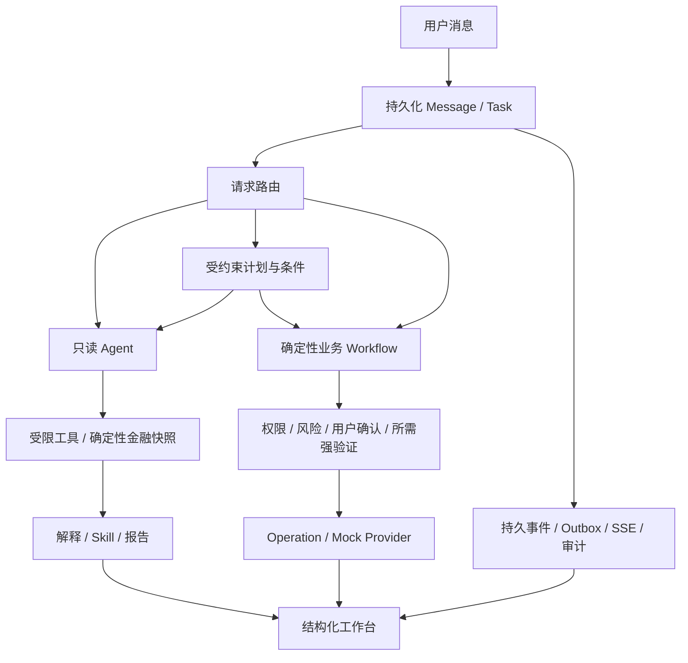

# AI Banking Agent

面向中文用户的个人银行智能助理。通过自然语言查询账户、分析账单、管理订阅和发起转账，并在工作台中展示核对、授权、执行与结果。

**当前版本：v0.10.3 · 数据库迁移：0033**

项目目前是可运行的模拟银行原型：银行数据为合成数据，转账、订阅扣费、强身份验证和 AA 参与者身份均使用 Mock。尚未连接真实银行、商户或支付渠道。

## 当前可以做什么

| 场景 | 当前能力 |
| --- | --- |
| 账户查询 | 查询账户与余额；展示账户身份、后端金额和查询时间 |
| 账单分析 | 按账户、自然月、自然年、最近 N 天或明确区间分析收入、支出、分类、主要交易及期间变化 |
| 消费报告 | 生成月度、年度报告，保存数据快照；支持历史查看、删除与恢复 |
| 异常提示 | 检查金额突增、短时重复、新商户大额和订阅涨价；普通分析附简短核对提示，明确询问时展开明细 |
| 订阅管理 | 识别周期扣费、费用与涨价；可管理订阅支持页面确认取消、对话取消及恢复续费授权 |
| 续费与消息 | 站内续费提醒、模拟自动扣费与结果消息；支持查看、标为已读和删除消息 |
| 即时转账 | 选择银行卡收款人和付款账户，核对金额与备注，确认并完成 Mock 强验证后提交 |
| 预约与周期转账 | 单次预约、有限次按月转账；预先核对并授权，到时重新校验执行，可管理未提交的预约 |
| AA 收款 | 平均或手动精确分摊；发布请求后，其他参与者以各自身份独立授权付款 |
| 多步骤任务 | 将已有能力组合为持久化计划；支持明确数值条件、等待用户操作、有限回退与人工接管 |
| 工作台管理 | 消费总览、报告、订阅、收款人、预约和 AA 页面；对话命名、删除、处理过程与审计链 |

v0.10.3 的主要变化是消息中心、订阅续费提醒与模拟扣费、页面内确认取消订阅，以及中文报告和统一导航。详见 [更新说明](docs/releases/release-notes-v0.10.3.md)。

## 试着这样使用

```text
我有哪些账户？工资卡余额多少？
分析一下工资卡最近30天的消费。
生成一份2026年8月份消费报告。
最近有没有异常交易？
我有哪些订阅？最近有没有涨价的？
取消星幕视频。
从工资卡给李小雨转1元，备注餐费。
明天早上9点从工资卡给物业转200元。
每月1号上午9点给物业转100元，共3次。
昨天聚餐100元，和张三、李四AA，我也参与。
查一下工资卡余额，如果余额不少于3000元，给张三转500元。
```

收款人、账户或时间存在歧义时，需要在核对界面补充或选择。预约须显式启用，AA 多身份演示另有配置，见 [转账与 AA 指南](docs/guides/transfers.md)。

## Agent 如何工作

LLM 负责理解请求、选择受限工具和解释结果；后端负责金融计算、权限、风险、授权及执行状态。



三个只读 Agent 分别处理账户、消费和订阅分析。产品运行时使用 LangGraph；业务写操作由确定性 Workflow 或受控 Domain API 执行。后台 Worker 负责持久任务执行、预约、操作恢复、事件发布和订阅消息。

- 金额、比例、分类和比较使用 Python `Decimal` 计算；前端使用后端结构化结果与展示字段。
- 查询自动执行；取消订阅需要确认；**所有转账及恢复订阅续费授权均需要确认和强验证**，不以金额大小豁免。
- **任务完成、预约创建或 AA 发布不代表付款成功。** 付款结果以原 Operation 和 Provider 的权威状态为准。
- `UNKNOWN` 表示结果仍在确认，继续查询原操作；幂等重试复用原操作，避免另建扣款。
- 身份由服务端 Principal 决定，数据与资源按用户隔离；模型不能授予权限或绕过安全写锁。

详细设计见 [系统架构](docs/architecture/system.md)、[金融计算与计划约束](docs/architecture/algorithms.md) 和 [安全与事实边界](docs/architecture/security.md)。

## 快速启动

准备 Docker Compose，在仓库根目录执行：

```bash
cp .env.example .env
```

在 `.env` 中填写可用的 OpenAI-compatible 模型配置，并设置本地 Mock 验证码：

```env
LLM_PROVIDER=openai_compatible
LLM_BASE_URL=https://your-provider.example/v1
LLM_API_KEY=your-key
LLM_MODEL=your-model
MOCK_REAUTH_CODE=your-local-code
```

`LLM_BASE_URL` 填 API 根路径，适配器会追加 `/chat/completions`。示例配置明确启用 development 身份。预约默认关闭，需要时设置 `MOCK_SCHEDULED_TRANSFERS_ENABLED=true`。Docker 示例启用模拟订阅自动扣费，可用 `MOCK_SUBSCRIPTION_BILLING_ENABLED=false` 关闭。

```bash
docker compose up --build -d
```

API 容器启动时自动迁移数据库。已有环境升级保留业务数据，详见 [环境配置与升级](docs/development/setup.md)。

| 入口 | 地址 |
| --- | --- |
| 对话工作台 | [localhost:3000](http://localhost:3000/) |
| 消费总览 | [Dashboard](http://localhost:3000/dashboard) |
| 消费报告 | [Reports](http://localhost:3000/reports) |
| 订阅管理 | [Subscriptions](http://localhost:3000/subscriptions) |
| 收款人管理 | [Payees](http://localhost:3000/payees) |
| 预约与周期任务 | [Scheduled transfers](http://localhost:3000/scheduled-transfers) |
| AA 收款 | [AA](http://localhost:3000/aa) |
| API 文档 | [OpenAPI](http://localhost:8000/docs) |

## 项目结构

```text
apps/api/             FastAPI、Agent、Workflow、金融计算、持久化与测试
apps/web/             Next.js / React 中文工作台
packages/api-client/  OpenAPI 生成的 TypeScript 类型与客户端
infra/postgres/       PostgreSQL 环境说明
scripts/              数据生成、校验、Smoke 与 Demo 工具
docs/
  guides/             当前使用指南
  architecture/       设计原则、系统架构、算法与安全边界
  development/        配置、开发、测试与演示
  releases/           版本更新说明
  archive/            历史实现、测试、审查与来源证据
```

后端使用 Python 3.12+、FastAPI、SQLAlchemy、Alembic 和 PostgreSQL；前端使用 Next.js 15、React 19 和 TypeScript。应用业务状态与 LangGraph checkpoint 分开管理。

## 开发与验证

本地开发需要 Python 3.12+、uv、Node.js 与项目指定的 pnpm，完整步骤见 [开发配置](docs/development/setup.md)。常用检查：

```bash
# 仓库根目录
uv run --project apps/api ruff check apps/api scripts
uv run --project apps/api pytest apps/api/tests -m 'not postgres'
pnpm web:lint
pnpm web:typecheck
pnpm --filter @banking/web test
pnpm web:build
```

PostgreSQL 集成测试与真实模型 Smoke 使用独立测试数据库。数据再生成、演示准备及验证方法见 [测试与演示](docs/development/testing.md)。历史测试记录保留原版本与日期，不作为当前版本重新执行的结果。

## 当前边界

- 转账仅支持人民币银行卡收款人；不支持手机号转账、换汇或真实银行扣款。Mock 强验证不等于真实 MFA。
- 预约和周期转账不冻结余额；到期可能因余额、安全锁或执行窗口失败。按月周期有限次，默认最多 12 次、跨度最多 366 天。
- 订阅识别基于固定月度／年度规则与模拟商户别名。仅可管理合同支持站内取消，其他检测项需到商户管理。提醒为站内消息，无短信或外部推送。
- 异常提示是确定性核对线索，不代表已确认欺诈，也不会自行触发安全熔断。
- 计划最多 8 步、2 个条件和一个写 Workflow；不支持任意代码、ELSE、循环、动态重规划或多个写业务。复杂计划暂不包含报告生成能力。
- SSE EventBus 为进程内广播，多 API 进程之间尚无实时消息代理与事件回放；业务资源 API 是事实来源。
- 尚未实现理财购买、卡片写操作、通用代码沙箱或完整生日联动。模型解释也没有逐句事实蕴含验证。

更多阅读入口见 [文档导航](docs/README.md)。
