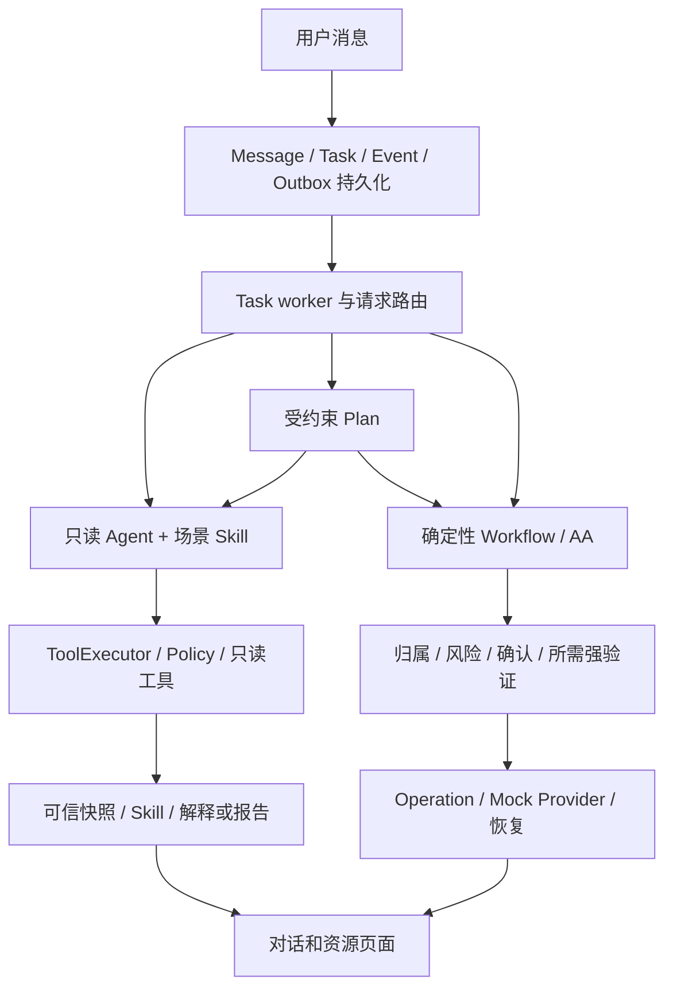

# 系统架构

## 模块职责

| 概念 | 职责 | 当前实现与详细说明 |
| --- | --- | --- |
| Agent | 选择获准的只读查询并解释事实 | [Agents 总览](agents/README.md)：PersonalBanking、SubscriptionAnalysis、WealthAdvisor |
| Agent Skill | 按场景加载专业指令与参考资料 | [Skills](skills.md)：八个标准包，三个绑定 Python 业务实现 |
| Tool | 提供有类型、调用者与风险约束的能力 | [Tools](tools.md)：查询、工作流提交和受控对账 |
| Workflow | 确定性推进补全、核对、授权与执行 | [Workflows](workflows.md)：转账、订阅取消／恢复、理财申购／赎回 |
| Plan | 组合已有高层能力 | [Plans](plans.md)：持久化有界 DAG、确定性条件和用户等待 |
| Domain API | 页面资源与受控业务动作 | [Domain APIs](domain-api.md)：总览、报告、订阅、收款人、预约、AA、消息和审计 |

六层是职责划分，Agent 详情分别见 [个人银行](agents/personal-banking.md)、[订阅分析](agents/subscription-analysis.md)、[理财顾问](agents/wealth-advisor.md)。Skill、Tool、Workflow 和 Worker 不另计为业务 Agent。

开发／测试环境登记三个 Agent；生产不登记 Mock 理财 Agent 和十一个理财工具。普通账户加消费请求由同一个 PersonalBankingAgent 完成；跨能力／工作流和条件请求进入 ConstrainedPlanner 与 PlanValidator。没有开放式 Agent 委派或任意代码执行。

## 消息到结果

消息接口持久化请求后返回，TaskExecutionWorker 领取执行。LangGraph 是产品运行时，提供有预算的工具循环及 PostgreSQL checkpoint；金融分析和理财路径固定使用它。Manual 用于基础查询参考及一致性验证。二者共用技能绑定、工具执行和策略边界。

消费工具计算 FinancialAnalysisSnapshot；报告技能校验核心和说明后保存 Report Artifact，异常技能解释检测器证据。账户、账单、订阅、理财结果按类型保存至 Task.output，前端从结构化事实呈现，不从自由文本推断付款成功。

Workflow 完成意图补全、校验、风险评估、确认及所需强验证；提交时重新核验并创建或复用 Operation。UNKNOWN 查询原操作。页面直接取消订阅通过 Domain API 校验归属、确认、合同版本、安全锁和幂等；不会扩大只读 Agent 权限。

AAService 管理请求和参与份额，参与者付款复用 Transfer Workflow。预约把内容、期次与时间窗口绑定为持久授权，ScheduleWorker 到时进入既有 OperationService。

## 数据与上下文

合成 JSON 提供账户、交易、收款人和合同基线；数据库账本保存成功转账、订阅扣费及理财现金变动。有效余额结合持久账本与占用读取，业务执行不改写 fixture。AccountStatementService 为页面、对话及消费分析提供同一已入账投影；消费分析额外排除转账和理财资产移动。

Alembic 管理应用表；LangGraph checkpointer 管理运行进度，两者职责独立。checkpoint 不替代 Task ownership、Workflow、Operation 或授权。Report、Task.output 及异常通知保存生成时快照；普通刷新不重算历史结论。多个资源查询不提供跨服务的全局原子快照。

个人银行续页保存可信查询条件与 as_of。理财追问读取本人本对话已完成分析的精简快照，按 SET／CLEAR／KEEP 更新需求，解析“第一款”等指代；新对话不继承旧预算或候选。账户测评可跨本人对话读取，但不是新的投资意愿或交易授权。没有独立长期记忆、向量记忆或跨用户共享上下文。

## 后台执行

| Worker | 职责 | 持久边界 |
| --- | --- | --- |
| TaskExecutionWorker | 领取和执行任务 | claim、lease、heartbeat、attempt fencing |
| OperationRecoveryWorker | 恢复未收敛资金操作 | 原 Operation、租约、退避与终态 |
| OutboxPublisher | 持久事件发布至 EventBus／SSE | Event 与 Outbox 同事务，领取重试 |
| ScheduleWorker | 到期预约／周期执行 | 唯一期次、持久授权、租约与提交复核；需开关 |
| SubscriptionNotificationWorker | 续费提醒、观察扣费、可选模拟扣费 | 用户锁、扫描游标、账期和消息去重 |
| AnomalyNotificationWorker | 近 30 天已入账消费异常提醒 | 规则检测、完整分页、用户和交易去重、证据快照 |

Worker 由 API lifespan 托管；不是独立通用队列平台。EventBus 为进程内广播，尚无跨进程 SSE broker 或重放；持久业务资源 API 是页面恢复事实来源。Worker 处理与通知不是同一事务时，不承诺资金状态变更与页面消息同时到达。

## 理财分析与交易

`wealth/` 管理目录、净值、测评、分析、订单、持仓、占用和现金账本。`knowledge/` 按版本、有效时间、hash 和作用域过滤后做关键词／别名检索，不调用向量数据库或在对话中联网。通用教育、Mock 产品条款和模拟设计画像分开，画像不覆盖原条款或独立生成的合成净值。

WealthAdvisoryService 共用确定性资格筛选、Decimal 费用情景、完整到账链路和历史窗口。模型结合已校验事实和检索证据生成正文；数字、关系、证据范围和资格检查失败时最多修复一次，再确定性降级。WealthRecommendationSkill 把校验后的分析转为客户 DTO，不能发起交易。推荐和对比从理财中心转到工作台发送需求并展示对话结果；HTTP 分析接口仍提供受限只读服务。

完整购买指令或填写产品卡后，通过 owner-scoped API／Workflow 创建核对草稿。草稿与对话、消息、任务及创建幂等键一起保存。修改数量、账户、日期或版本使旧授权失效；元和份不能互换，全部赎回绑定明确份额。

账户写入共享余额锁。理财按安全用户锁 → Workflow → 账户 → 持仓 → 订单／占用取锁，不持锁等待模型。受理、成交、结算使用短事务；申购成交与结算同事务，赎回成交及到账分阶段。已受理订单使用原条款，只有最终结算才产生相应金融成功事实。

关闭新理财业务后，已受理订单及 UNKNOWN 原操作继续恢复，不能借关闭开关撤单或释放占用。允许删除的已受理理财对话仅隐藏对话，保留订单、账本、审计和恢复链。

## 源码入口

| 模块 | 入口 |
| --- | --- |
| 应用、登记与生命周期 | [main.py](../../apps/api/src/banking_api/main.py) |
| 请求路由与任务 | [RequestRouter](../../apps/api/src/banking_api/routing/request_router.py)、[TaskRunner](../../apps/api/src/banking_api/runtime/task_runner.py) |
| Agent 与场景 | [三个 Agent 及场景](agents/README.md) |
| 技能与工具 | [Skills](skills.md)、[Tools](tools.md) |
| LangGraph | [graph.py](../../apps/api/src/banking_api/runtime/langgraph/graph.py) |
| 账单事实 | [AccountStatementService](../../apps/api/src/banking_api/application/account_statement_service.py) |
| 工作流与恢复 | [工作流](workflows.md)、[OperationService](../../apps/api/src/banking_api/application/operation_service.py) |
| 计划 | [Plans](plans.md)、[PlanValidator](../../apps/api/src/banking_api/planning/validator.py) |
| 业务 API | [资源与动作](domain-api.md) |
| Web 工作台 | [page.tsx](../../apps/web/app/page.tsx) |

HTTP 契约以运行中的 `/openapi.json` 和 `/docs` 为准；`packages/api-client` 使用 `pnpm api:generate` 生成 TypeScript 类型。权限与结果边界见 [安全说明](security.md)，部署排查见 [运行维护](../development/operations.md)。
