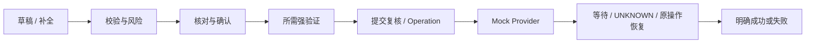

# Workflow：确定性业务办理

## 职责与实现

Workflow 推进明确状态转换，处理补全、业务校验、核对、确认、强验证、Operation 提交和恢复。它使用确定性代码，不把金融授权交给 Agent 或 LangGraph 工具循环。

| 业务 | 类型／执行者 | 确认与执行 |
| --- | --- | --- |
| 即时转账 | TRANSFER／TransferWorkflowEngine | 单笔严格小于个人免密额度（最高200元）且日累计风险暴露≤1000元时确认；否则另须强验证，提交重新评估 |
| 预约／周期转账 | TRANSFER 草稿 + ScheduleService | 确认及强验证生成固定期次、内容和执行窗口的持久授权，到期逐项执行 |
| 订阅取消 | SUBSCRIPTION_CANCEL／SubscriptionCancellationWorkflow | YELLOW 确认后受控取消 |
| 订阅恢复 | SUBSCRIPTION_RESUME／同一订阅引擎 | RED 确认及强验证，恢复未来授权，不立即扣费 |
| 理财申购／赎回 | WEALTH_PURCHASE、WEALTH_REDEEM／WealthWorkflow、WealthExecutionEngine | 明确数量、账户、条款和交易日，确认及强验证，异步成交／结算 |

AAService 的发布与份额管理属于业务服务；参与者付款复用 TRANSFER，不是单独的只读 Agent。页面直接取消订阅是受控 Domain API，仍校验确认、归属、版本、安全锁和幂等。

## 输入、授权与状态

模型只提取自然语言意图，账户、收款人、产品和数量必须解析为本人可用对象，歧义等待用户选择。READY_FOR_REVIEW 只表示草稿初检通过；READY_FOR_COMMIT 只表示当时满足授权条件，不保证提交时余额仍足够。

Approval 绑定 canonical payload hash，Reauthentication 绑定具体 Approval；默认有效期为 600／300 秒。修改账户、金额、备注、份额或绑定日期／资料版本使旧授权失效。预约持久授权不延长全局 TTL，也不允许挪作即时付款。

提交重新检查身份、状态、风险、安全写锁、租约、授权、余额／份额及幂等；Operation 与 Provider 继续验证持久业务类型、本人归属和 payload。模型“确认了”不能代替用户动作。

## Tool 与恢复边界

五个 R4 提交和三个 R3 对账只允许对应 Workflow caller；Operation 工具只接收 operation_id，加载持久授权参数。对账可能推进结算，因此不是 Agent 可调用的只读工具；普通订单／持仓 GET 仍纯读取。完整清单见 [Tools](tools.md)。

OperationRecoveryWorker 恢复同一个 Operation，沿用原授权和幂等身份、领取租约与退避。UNKNOWN 保留占用和最后阶段，不新建扣款。Task heartbeat／attempt fencing、业务版本和账户锁防止旧执行者覆盖新尝试，不把 checkpoint 当作资金事实。

理财受理只占用资金／份额；申购成交与结算同事务，赎回成交及到账分阶段，SETTLED 才表示最终结算。安全写锁或关闭新理财业务不阻止已受理兑付。预约创建／AA 发布也不表示已付款。

## 取消、删除与验证

只允许取消未提交草稿或符合规则的未提交预约／份额；已提交或未知操作继续恢复。删除对话／列表／通知不撤销金融业务；理财受理后不可撤单。Plan 的回退不跨越写工作流。

源码：[转账引擎](../../apps/api/src/banking_api/workflows/transfer/engine.py)、[订阅引擎](../../apps/api/src/banking_api/workflows/subscription_cancel/engine.py)、[理财工作流](../../apps/api/src/banking_api/wealth/workflow.py)、[OperationService](../../apps/api/src/banking_api/application/operation_service.py)、[ScheduleService](../../apps/api/src/banking_api/application/schedule_service.py)。

验证包含核对／授权失效、跨用户拒绝、幂等、超时／未知恢复、锁竞争和资金守恒，PostgreSQL 并发测试不可由 SQLite 替代。见 [测试](../development/testing.md)、[安全](security.md) 及 [转账用法](../guides/transfers.md)。
