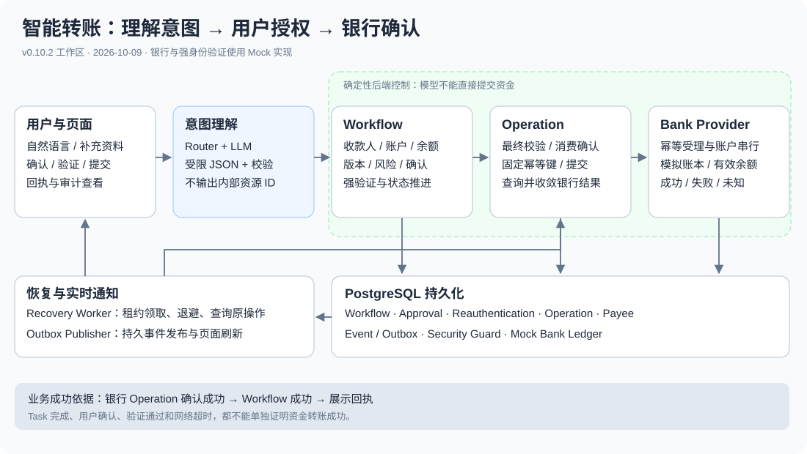
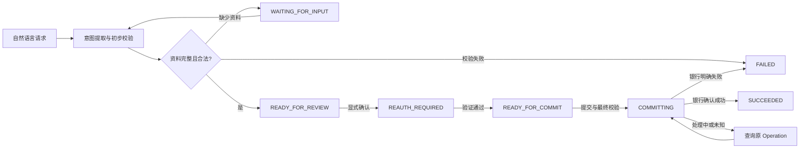
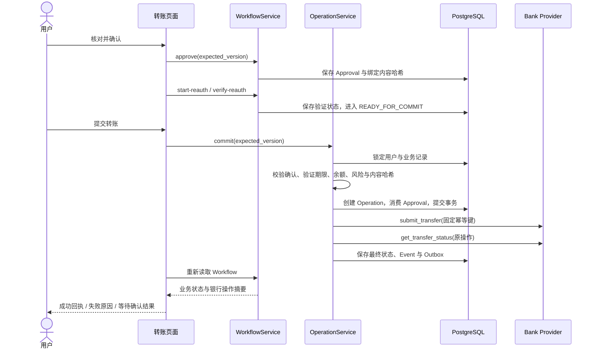

# 历史档案：智能转账功能与实现说明

> 历史材料，保留原记录日期、版本和结论。旧风险规则、待办事项、测试数量与本地部署状态不代表 v0.10.3；当前说明见 [文档导航](../../../README.md)。

更新日期：2026-10-09。基于当前 **v0.10.2 工作区代码**，包含账户查询、收款人管理，以及备注、单次及按月周期预约和 AA 收款扩展；这些修改可能尚未提交到 Git。本文与目录中基于 v0.9.2 的历史审查报告分别记录不同时间的实现。

## 1. 功能概览

智能转账允许用户用自然语言发起转账，再通过页面补充资料、确认、验证和提交。系统采用“模型理解意图 + 后端确定性工作流 + 银行 Provider”的实现方式。

例如，用户输入“从工资卡给张三转 10 元”，系统提取收款人、金额、币种和付款账户提示。如果有两个张三，会展示银行和账号尾号供用户选择；资料完整后展示核对信息。用户确认并完成强身份验证后，还需点击提交，最终以银行操作状态决定是否成功。

当前银行数据、转账 Provider 和强身份验证均为 **Mock 实现**，转账不会进入真实银行清算网络。页面上的成功表示模拟银行账本中的操作成功。

| 功能 | 当前行为 |
|---|---|
| 自然语言发起 | 提取姓名或别名、金额、币种、付款账户提示；缺失信息不猜测 |
| 收款人匹配 | 后端按姓名或别名规范化搜索候选；简称匹配及同名均必须由用户选择 |
| 资料补全 | 可选择已有收款人、新增收款人、补充金额、选择付款账户 |
| 账户校验 | 仅允许 ACTIVE 的 DEBIT、SAVINGS 账户；验证归属、币种和有效余额 |
| 用户确认 | 显式确认当前转账内容；修改核心资料后原确认失效 |
| 强身份验证 | 当前每笔资金支出都需要；使用模拟验证 Provider |
| 提交与回执 | 单独提交；银行明确成功后显示回执、参考号与完成时间 |
| 超时恢复 | 保留原 Operation 和幂等键，查询原操作结果，支持后台恢复 |
| 收款人管理 | 新增、编辑、删除；账号输入完整数字，核对和后续查询仅显示后四位 |
| 转账备注 | 100 个 Unicode 字符内普通文本，变更后重新确认和强验证；历史快照保留 |
| 单次预约 | 独立、可撤销、一次消费的 Mock 授权；持久化 Worker 到期执行 |
| 按月周期预约 | 用户确认有限次日期及总额；不可变范围派生逐期一次性授权，可撤销未提交期次 |
| AA 收款 | 整数分分摊、自付不扣款、逐人独立授权；Mock 成功后幂等入账 |
| 查询与审计 | 余额查询直接回复；处理过程、审计链、已完成事件可查看和定位 |

当前支持 CNY 转账，不支持换汇、信用卡作为付款账户或直接向任意未登记账号转账。

## 2. 页面上的使用流程

1. 在工作台输入转账请求，例如“从工资卡给张三转 10 元”。也可以只说“我想给张三转账”，随后补充缺失资料。
2. 若收款人同名，核对银行、账号尾号和别名，选择目标收款人。找不到时可进入收款人管理新增，再返回原对话继续选择。
3. 补充转账金额，选择付款账户。页面展示账户尾号和后端提供的可用余额。
4. 核对转出账户、收款人、银行、金额和币种，点击“确认这笔转账”。此时尚未提交银行。
5. 按页面要求完成模拟强身份验证。验证通过后仍需提交。
6. 点击提交转账。若显示处理中或结果未知，查询原操作结果，避免重新发起同一笔转账。
7. 只有银行操作确认成功后，页面才展示转账回执，并将事件收录到对话右侧的已完成事件索引。

提交前可取消，或者通过卡片修改金额、收款人或付款账户。修改后需要重新核对和授权。进入 COMMITTING 后，当前产品不提供普通取消按钮，也没有银行撤回或冲正功能。

账户余额查询与资金转账使用不同呈现：余额查询合成一条助理回复，时间按 `YYYY-MM-DD HH:mm:ss` 显示北京时间；转账保留交互卡片，因为需要选择、确认、验证和提交。

## 3. 实现架构与职责



图中横向箭头表示请求推进，下方持久化层保存业务状态和证据。模型只参与意图理解，不持有直接提交资金的工具权限。

| 层次 | 主要实现 | 职责 |
|---|---|---|
| 对话入口 | [TaskRunner](../../../../apps/api/src/banking_api/runtime/task_runner.py)、[RequestRouter](../../../../apps/api/src/banking_api/routing/request_router.py) | 接收任务、分类请求、选择执行器、关联对话和 Workflow |
| 意图提取 | [TransferIntentExtractor](../../../../apps/api/src/banking_api/workflows/transfer/intent_extractor.py) | 模型输出受限 JSON，Pydantic 校验后形成 TransferIntent |
| 工作流引擎 | [TransferWorkflowEngine](../../../../apps/api/src/banking_api/workflows/transfer/engine.py) | 匹配收款人、选择账户、校验金额/币种/余额、生成核对内容 |
| 应用服务 | [WorkflowService](../../../../apps/api/src/banking_api/application/workflow_service.py) | 持久化状态、版本控制、用户确认、验证、取消、授权失效 |
| 提交服务 | [OperationService](../../../../apps/api/src/banking_api/application/operation_service.py) | 最终校验、消费确认凭据、创建幂等操作、提交和查询结果 |
| 银行边界 | [TransferProvider](../../../../apps/api/src/banking_api/transfers/provider.py)、[MockTransferProvider](../../../../apps/api/src/banking_api/transfers/mock_provider.py) | 银行受理、幂等处理、模拟账本和状态查询 |
| 页面 | [TransferWorkflowCard](../../../../apps/web/features/workflows/transfer/TransferWorkflowCard.tsx)、[PayeeSelector](../../../../apps/web/features/workflows/transfer/PayeeSelector.tsx) | 依据后端状态展示操作按钮，不自行决定授权或业务成功 |
| 恢复与证据 | [恢复 Worker](../../../../apps/api/src/banking_api/runtime/operation_recovery_worker.py)、[Outbox Publisher](../../../../apps/api/src/banking_api/runtime/outbox_publisher.py)、[Audit Projection](../../../../apps/api/src/banking_api/audit/projection.py) | 重启后继续查询、发布事件、生成脱敏审计视图 |

### 3.1 模型如何参与

Router 将单笔转账请求分配到 `TRANSFER_WORKFLOW`。TaskRunner 调用意图提取器，语义字段包括收款人查询、金额、币种、付款账户提示、备注及时间原文：

```json
{
  "recipient_query": "张三",
  "amount": "10.00",
  "currency": "CNY",
  "source_account_hint": "工资卡",
  "remark": "餐费",
  "execution_time_text": null
}
```

金额使用十进制字符串，未表达的字段为 null。提取器不允许模型输出 payee_id、account_id、workflow_id 等内部标识；这些标识必须由后端读取真实候选数据后确定。无效输出最多重试一次，仍不合法则终止意图提取。

TaskRunner 根据 source_task_id 查找并复用已建立的 Workflow，减少任务重试重复建流程的风险。建立 Workflow 并回复用户之后，对话 Task 就可以 COMPLETED，后续确认和提交继续修改 Workflow。

**Task COMPLETED 表示请求处理完成；它不等于转账成功。**

### 3.2 工作流如何确定下一步

`TransferWorkflowEngine.advance()` 每次根据当前草稿重新读取银行工具数据：

- 缺少收款人查询词：等待输入姓名或别名；搜索无结果时允许新增或重新选择。
- 存在多个匹配收款人：等待用户选择；后端验证选择的 ID 属于当前候选集合。
- 缺少金额：等待输入；金额必须大于 0、有限且最多两位小数。
- 付款账户未确定：列出符合类型与 ACTIVE 状态的账户；账户提示唯一匹配时可自动解析，否则等待选择。
- 币种未指定：取付款账户币种；指定币种必须与账户一致，当前风险策略还要求 CNY。
- 余额不足或账户不合法：生成确定性校验错误，停止推进。
- 资料合法：生成 TransferReviewPayload，进入 READY_FOR_REVIEW。

工具执行经过 ToolExecutor 和 PolicyService，检查调用方、Principal、能力白名单、输入与输出模型。只读银行助理没有 `transfer.commit` 能力；真正提交由 `workflow:transfer` 调用。

## 4. 状态、确认与提交时序

主路径如下；等待信息、取消、验证失败和超时会产生分支。



Workflow 表示一笔转账的交互流程，Operation 表示一次已授权的资金操作。Operation 的状态包括 CREATED、SUBMITTED、UNKNOWN、SUCCEEDED、FAILED；UNKNOWN 是结果尚不确定，需要恢复查询，不应展示成成功或直接重新扣款。



### 4.1 确认绑定的内容

授权模块将以下核心字段规范化后，生成排序稳定的 JSON，再计算 SHA-256：

```json
{"amount":"10.00","currency":"CNY","payee_id":"payee_001","source_account_id":"acc_salary"}
```

金额固定为两位小数、币种大写。Approval 记录绑定这个 payload_hash，Reauthentication 绑定当前 Approval。修改金额、收款人或付款账户会使原授权失效；提交时也会重新计算和比对。

默认确认有效期为 600 秒，验证有效期为 300 秒，可通过配置调整。过期或不匹配的凭据不能继续提交。Approval 在创建 Operation 的事务中被消费，不能再次用于一笔新资金操作。

### 4.2 最终提交重新校验

OperationService 不直接信任页面上的 READY_FOR_COMMIT。它依次检查用户归属、expected_version、工作流状态、Security Guard、Approval 状态及期限、payload_hash、工具权限，再调用引擎重新读取账户和收款人数据、检查余额和币种、重算风险并检查强验证。

只有通过这些检查，才在同一数据库事务内创建 Operation、消费 Approval、把 Workflow 改为 COMMITTING，并保存事件和 Outbox 发布意图。Provider 调用在后续阶段执行，外部超时不会抹去已创建的操作记录。

## 5. 风险、身份和并发控制

### 5.1 当前每笔支出都需要强验证

当前 [TransferRiskPolicy](../../../../apps/api/src/banking_api/workflows/transfer/risk.py) 对合法转账统一返回 RED，并要求 approval 和 reauthentication。代码保留了 1000.00 元 threshold 字段和当日风险暴露统计，但 **当前没有“小于 1000 元免验证”的分支**。

当日风险暴露为：

`当日已成功金额 + 当日执行中风险暴露 + 本笔金额`

该统计按业务时区划分日期，用于风险信息与提交前检查。前端展示的红色业务风险等级，与工具能力层用于权限分类的风险枚举是不同概念。

### 5.2 身份与安全锁

Principal 由认证边界提供，数据库资源和银行查询以内部 user_id 做归属过滤。开发模式使用配置的开发身份；OIDC 模式验证身份后映射为内部用户。不能靠客户端填写另一个 user_id 取得其业务资源。

Mock 强验证使用配置的模拟验证码并以常量时间比较校验，验证码不会作为业务凭据写入表中。它提供流程演示，不等同于真实银行短信、设备认证或生物识别。

Security Guard 持久化验证失败及绕过控制的信号。默认在 600 秒窗口内累计 3 次验证失败，或在 300 秒窗口内累计 5 次绕过信号后，将新写操作临时锁定 900 秒。查询和已有 Operation 的结果收敛仍可继续。最终行为以配置和后端状态为准。

### 5.3 并发与金额处理

- Workflow 操作携带 expected_version，更新时校验版本，避免旧页面覆盖新状态。
- PostgreSQL 行锁与用户级事务 advisory lock 用于序列化授权、风险和新 Operation 创建。
- Provider 另对付款账户串行校验余额，不能仅依赖用户确认时的余额快照。
- 金额计算使用 Decimal，API 序列化为字符串，避免二进制浮点误差。
- 当前 Mock 有效余额为 fixture 初始余额减去已成功模拟转账支出；余额查询工具可读取这一本账本结果。

数据库事务只能原子化应用侧记录，不能把外部银行调用纳入同一个数据库事务。跨边界重复提交风险依靠幂等键、Provider 唯一约束和恢复机制控制，不能据此宣称任意真实银行上的 exactly-once 保证。

## 6. 幂等与异常恢复

创建 Operation 时生成固定 idempotency_key。同一 Workflow 重复提交会查找并返回已有 Operation；Provider 收到相同用户和幂等键时复用原处理结果，不再次产生模拟账本支出。

Mock Provider 支持成功、明确失败以及“银行已经受理但响应超时”的故障模式。最后一种情况下，应用无法从超时判断失败，应标记结果未知并查询原操作。

OperationRecoveryWorker 定期扫描到期的非终态操作，以持久化 lease 领取任务。租约和版本条件限制过期 Worker 写回结果；重启后可从数据库中的 Operation 继续恢复。重试使用退避策略，保留同一操作与幂等键。

页面也提供结果查询入口。它先读最新 Operation 版本，再调用 reconcile，刷新 Workflow。最终只有银行明确返回 SUCCEEDED，应用才把 Operation 和关联工作流收敛为成功。

事件通过 Event + Outbox 与业务状态一起落库，再由 Outbox Publisher 发布。实时通知是提示，刷新后的 GET API 是业务事实来源；通知可能重复，前端需要按事件身份和业务版本处理。

## 7. 收款人管理与转账联动

[收款人页面](../../../../apps/web/app/payees/page.tsx) 与 [PayeeService](../../../../apps/api/src/banking_api/payees/service.py) 提供完整管理流程：

| 操作 | 实现行为 |
|---|---|
| 新增 | 输入 12～32 位数字完整账号，允许输入过程中去除空白，核对后确认保存 |
| 脱敏 | 核对、列表和转账选择只显示 `****` 加后四位，不返回完整账号 |
| 账号识别 | 数据库存后四位和 SHA-256 指纹；不同完整账号即使尾号相同也可区分 |
| 编辑 | 修改姓名、银行、别名；账号留空保留原值，填写新完整账号时更新指纹和尾号 |
| 删除 | 设置 deleted_at，列表和查询过滤已删除条目，保留记录 |
| 初始收款人 | 用 source_payee_id 保存用户自己的编辑或删除覆盖，不修改公共 fixture 文件 |
| 使用中保护 | 若未结束 Workflow 的 draft 已选中该收款人，编辑和删除返回 PAYEE_HAS_ACTIVE_TRANSFER |
| 转账联动 | PayeeSelector 和 search_payees 读取管理后的数据；新增后可返回原对话继续选择 |

当前完整账号不会以明文保存在收款人表中，Mock Provider 按 payee_id 执行。因此这套指纹方案只解决模拟产品的识别与脱敏展示；真实银行接入还需要可被银行使用的安全账号标识、Token 或受保护的账号存储。SHA-256 指纹也不等同于账号加密。

“新增收款人”的确认与“确认这笔转账”的 Approval 是两件事。保存联系人不会授权后续转账；每笔转账仍走独立确认和验证。

## 8. 页面状态、回执与审计

前端从后端 Workflow presentation 读取账户选项、金额显示、风险信息和业务成功标记。按状态决定哪些按钮可用；错误后也刷新资源，避免页面保留过期状态。

[WorkflowReceipt](../../../../apps/web/features/results/WorkflowReceipt.tsx) 展示金额、收款人、银行、付款账户尾号、业务进度和 Provider 参考号。[会话时间线](../../../../apps/web/features/conversation/timeline.ts) 在缺少 presentation 时，要求 Workflow 和 Operation 都是 SUCCEEDED 才把结果当作成功。

审计链关联 Task、Workflow、Approval、Reauthentication、Operation 与事件。审计视图说明执行步骤、风险决策和结果，不展示模型隐藏推理、完整 Prompt、验证码或 API Key。历史回执保留当时的核对内容，后续编辑联系人不应改写既有业务证据。

## 9. 主要 API 与数据模型

以下路径均以 `/api/v1` 为前缀。除收款人接口外，工作流状态变更通常要求 expected_version；请求的用户身份来自认证依赖。

| 路径 | 方法 | 用途 |
|---|---|---|
| `/conversations/{id}/messages` | POST | 输入自然语言，创建对话 Task |
| `/workflows`、`/workflows/{id}` | GET | 恢复和读取业务流程 |
| `/workflows/{id}/actions/select-payee` | POST | 选择权威候选收款人 |
| `/workflows/{id}/actions/set-recipient-query` | POST | 修改收款人查询词 |
| `/workflows/{id}/actions/select-source-account` | POST | 选择付款账户 |
| `/workflows/{id}/actions/set-amount` | POST | 补充或修改金额 |
| `/workflows/{id}/actions/approve` | POST | 明确确认并生成绑定内容的 Approval |
| `/workflows/{id}/actions/start-reauth` | POST | 发起强验证挑战 |
| `/workflows/{id}/actions/verify-reauth` | POST | 提交验证结果 |
| `/workflows/{id}/actions/commit` | POST | 最终校验、创建并提交 Operation |
| `/workflows/{id}/actions/cancel` | POST | 提交前取消并使授权失效 |
| `/operations/{id}` | GET | 查询资金操作状态 |
| `/operations/{id}/actions/reconcile` | POST | 查询并收敛原操作结果 |
| `/payees` | GET / POST | 列出、新增收款人 |
| `/payees/{id}` | PATCH / DELETE | 编辑、软删除收款人 |
| `/tasks/{id}/audit` | GET | 读取脱敏审计链 |

主要持久化记录见 [models.py](../../../../apps/api/src/banking_api/persistence/models.py)：Conversation/Message 保存对话，Task 保存请求执行，Workflow 保存业务草稿和状态，Approval/Reauthentication 保存授权，Operation 保存应用侧资金操作，MockBankTransfer 保存模拟银行账本，Payee 保存联系人，Event/Outbox 保存证据和通知意图。

收款人账号指纹对应迁移 0021，编辑覆盖和软删除对应迁移 0022。旧收款人只有尾号的记录仍可展示和编辑；只有输入新完整账号后才有对应的完整账号指纹。

## 10. 验证方法与阅读入口

建议按以下顺序阅读代码：意图提取器 → TransferWorkflowEngine → WorkflowService → OperationService → MockTransferProvider → TransferWorkflowCard。下列测试是实现规则的可执行依据：

| 测试文件 | 重点 |
|---|---|
| [test_transfer_workflow.py](../../../../apps/api/tests/test_transfer_workflow.py) | 资料缺失、同名、账户选择与业务校验 |
| [test_transfer_authorization.py](../../../../apps/api/tests/test_transfer_authorization.py) | 确认、强验证、有效期与授权绑定 |
| [test_transfer_operations.py](../../../../apps/api/tests/test_transfer_operations.py) | 提交、状态查询、失败及幂等 |
| [test_provider_concurrency.py](../../../../apps/api/tests/test_provider_concurrency.py) | Provider 并发与余额边界 |
| [test_operation_recovery.py](../../../../apps/api/tests/test_operation_recovery.py) | 租约、重启和不确定结果恢复 |
| [test_transfer_risk.py](../../../../apps/api/tests/test_transfer_risk.py) | 风险计算与提交时重评估 |
| [test_transfer_currency_policy.py](../../../../apps/api/tests/test_transfer_currency_policy.py) | CNY 限制与币种一致性 |
| [test_security_guard.py](../../../../apps/api/tests/test_security_guard.py) | 安全信号、锁定与恢复 |
| [test_payee_management.py](../../../../apps/api/tests/test_payee_management.py) | 编辑、删除、用户隔离、使用中保护 |
| [test_transfer_payee_shortcuts.py](../../../../apps/api/tests/test_transfer_payee_shortcuts.py) | 新增和选择收款人与转账联动 |
| [test_authoritative_accounts.py](../../../../apps/api/tests/test_authoritative_accounts.py) | 权威余额与转账后的余额更新 |

在仓库根目录可运行核心验证：

```bash
apps/api/.venv/bin/pytest \
  apps/api/tests/test_transfer_workflow.py \
  apps/api/tests/test_transfer_authorization.py \
  apps/api/tests/test_transfer_operations.py \
  apps/api/tests/test_operation_recovery.py \
  apps/api/tests/test_payee_management.py
```

PostgreSQL 的跨进程锁、约束与恢复行为应使用独立测试数据库验证，不能用 SQLite 测试替代。本次执行结果与网页验收限制详见 [本次验证记录](transfer-validation.md)。网页验收可依次检查：同名收款人选择 → 缺失金额补全 → 付款账户选择 → 确认 → 验证 → 提交 → 回执；异常分支检查余额不足、过期验证、重复提交和结果未知。

复杂条件转账另走受约束 Plan/DAG：规划只能选择预注册能力，条件由后端判定，写步骤最终仍建立上述 Workflow 并等待用户授权。它不赋予模型绕过确认直接付款的能力。

## 11. 当前边界

- 实际银行接入、真实身份验证、收款账户真实性核验及清算对账尚未实现；现有 Provider 为模拟边界。
- 当前只支持 CNY；支持 Mock 单次及有限次按月周期预约，不支持真实银行周期扣款、换汇、直接批量扣款、银行撤回或冲正。
- 姓名/别名候选匹配和候选数量有明确边界，不能把模糊模型推荐当作收款账户确认。
- 收款人软删除保留记录，但当前页面没有回收站或恢复入口。
- 收款人编辑接口未提供与 Workflow 相同的 expected_version 参数；跨客户端联系人编辑的版本冲突控制仍可进一步完善。
- 历史文档可能描述旧的风险阈值策略，当前行为以本文件所指代码和后端返回结果为准。

## 12. 转账扩展

### 12.1 备注与兼容性

“给张三转 100 元，备注本月餐费”仅提取明确表达的 `remark`，未提供时为空。后端统一去除前后空白，限制最多 100 个 Unicode 码点，拒绝控制字符和格式控制字符。页面以普通 React 文本显示，备注不能成为模型指令或后端动作。

非空备注使用 canonical payload v2，并参与确认哈希；空备注、普通姓名即时转账仍保留原来的四字段 JSON，已有授权的哈希不因新增字段变化。修改备注使 Approval 和强验证失效。Operation 与 Mock 银行账本保存提交时备注，回执从历史 Workflow 快照读取，不依赖后来编辑的联系人。

### 12.2 单次预约及授权

“明天早上 9 点从工资卡给张三转 200 元，备注房租”先提取原始时间，再由 `ExecutionTimeExtractor` 调用 LLM 提取受限时间语义：相对天数、明确日期、周几及周偏移、24 小时制时分秒或相对分钟。运行中的应用不依赖固定词语匹配来理解自然语言时间；“明早九点半”“下周五下午三点四十五”“两小时后”等语义由模型提取。模型不能计算内部 ID、选择账户、猜测缺少的时刻或授权。后端 `resolve_time_intent` 以 Task 请求接收时间和 Asia/Shanghai 计算日期，校验歧义、冲突和期限，再展示给用户确认。时间模型调用在任务写锁之前进行；编辑先校验归属再提取，之后检查版本取得事务锁。保留旧程序化客户端的确定性时间接口，但生产应用明确绑定 LLM 时间提取器。绝对时间可输入 `2026-10-09 09:00`；“晚上”“下周”或无法唯一确定的表达要求补充。过去、提前量不足、超出预约期限均拒绝，保存 UTC 执行时刻、最晚执行期限和业务时区。

完成原有确认及强验证后，用户还需显式点击“授权并创建预约”。`ScheduleService` 把短期确认转换为独立的持久化授权，而不是延长 Approval 600 秒或强验证 300 秒的有效期。记录绑定预约、付款账户、收款目标及账号指纹、金额、CNY、备注、执行时刻、最晚期限、payload_hash 和已验证身份；保存撤销/消费时间，不保存验证码。普通即时提交接口不能使用这份授权，其他预约和 AA 也不能消费它。

仅当 `MOCK_SCHEDULED_TRANSFERS_ENABLED=true` 且当前引擎声明 Mock Provider 能力时允许转换。预约不冻结余额。`ScheduleWorker` 使用数据库 `FOR UPDATE SKIP LOCKED`、lease 与版本领取，到期进入原 `OperationService.prepare_transfer`，重新检查账户、收款路由、余额、币种、风险、安全锁与授权范围。执行窗口外未提交的预约过期，不无限补扣；已经受理而 UNKNOWN 的 Operation 仍交给原 OperationRecoveryWorker，执行窗口结束不会停止查询。

所有提交和取消使用 Security → Workflow → Schedule 锁顺序。取消先获得事务锁则撤销授权，不能再扣款；Operation 已创建则不能普通取消，应查询原操作。一个预约最多关联一个 Operation，重试复用它的幂等键。核心字段或时间修改会撤销预约授权，回到重新确认与强验证。

预约状态：`PENDING_AUTHORIZATION` 待授权、`SCHEDULED` 已预约、`EXECUTING` 执行中、`UNKNOWN` 结果未知、`SUCCEEDED` 付款成功、`FAILED` 失败、`CANCELLED` 已取消、`EXPIRED` 已过期。后三种成功/失败/未知资金状态从关联 Operation 投影，不从 Task 完成推断。

### 12.2.1 有限次按月周期转账

支持“每个月1号早上9点给物业转账100元，共3次”。缺少时刻或总次数时要求补充，不默认无限期扣款。首版规则仅按月、2 至 12 次、最长 366 天；29/30/31 日没有对应日期的月份跳过，所有实际日期均在核对卡逐项展示。卡片展示每期金额、授权总额、全部执行日期、收款人、付款账户及备注。简称“物业”搜索到“青禾物业”后仍必须选择确认。

完成原有核对、短期确认和强验证后，显式点击“授权并创建周期转账”。新增 `RecurringTransferModel` 保存原确认 canonical scope、hash、原 Approval 与强验证证据、授权时间及撤销时间；payload_version=5 绑定完整周期规则及不可变日期数组。一次授权在事务内生成有限个独立预约与一次性 grant，每个期次都有自己的 Task、Workflow、消费证据和 Operation 唯一约束。派生消费证据从一开始为 CONSUMED，不是新的用户批准，也不能用于即时转账；不制造或保存验证码。Worker 验证原周期 scope hash、原用户确认与强验证来源、期次归属、执行日期和 grant payload，才进入原 `OperationService`。全局 600/300 秒凭据有效期不变，只有独立 Mock 周期授权适用预先核对的未来范围。

`scheduled_transfers` 增加 `series_id`、`occurrence_index`，PostgreSQL 的 `(series_id, occurrence_index)` 唯一约束保证一个周期一期只存在一个预约。每期使用原 Worker 的 lease、SKIP LOCKED、风控、Security Guard、余额复核、幂等 Operation 和恢复。未提交的迟到期次过期，不无限补扣；已经 UNKNOWN 的期次继续查询原 Operation，不重建扣款。某一期失败不代表其他期次成功，也不自动改金额或补扣。

列表逐期显示结果，允许取消本期或“撤销后续周期授权”。后者与所有期次准备提交共用用户 Security 事务锁，撤销成功后未提交期次全部取消；已提交或 UNKNOWN 继续查询，既有回执保留。授权后核心内容和日期不可直接编辑；撤销后重新创建并授权。审计关联周期、期次、原确认及强验证证据。此功能仅 Mock，真实 Provider 不得启用。

### 12.3 AA 请求与参与者付款

“昨天聚餐 268 元，和张三、李四、王五 AA，我也参与”只创建草稿。模型提取总额、姓名、发起者是否参与、账户提示、主题和明确指定的手动金额；姓名映射到站内 Mock 登记身份由后端执行，模型不能提供内部用户或账号 ID。发起者是否参与未说明时必须选择，收款账户未给出也必须选择。

金额全程使用 Decimal 和整数分。平均分摊按确认的参与者顺序分配余数，发起者参与时追加在末尾；100 元三人得到 33.34、33.33、33.33 元。手动输入如 `张三=40、李四=30、我=30`，逐人金额严格校验，必须总和一致，拒绝重复、负数、零付款项与超精度。核对页展示逐人金额、完整截止时间、主题和收款账户尾号；修改未保存资料时不能发布旧预览。

显式发布生成不可变 AA 主快照和逐人份额，**发布不扣款**。自己的份额是 `SELF_PAID`，页面显示“自己承担”，不创建自付 Operation，也不表示系统已完成这部分付款。卡片提示无需向自己转账，其他参与者通过“AA 收款与付款”以自己的身份独立付款。截止日期使用北京时间显示，不附带技术时区名称。已发布的金额/参与者不能覆盖；需要点击“撤回收款请求”、核对姓名和金额并确认撤回，再在工作台重新创建请求；撤回不会自动将金额重新分摊给其他人，已付款证据保留。首版截止时间默认创建后 7 天，可在发布前修改并确认。

参与者以自己的认证 Principal 查看站内请求，选择自己所属的付款账户，建立固定目标的 Transfer Workflow，再独立确认、强验证和提交。收款目标、金额和备注从 AA 快照获取，付款人和模型都不能替换。一个份额最多一个付款 Workflow/Operation，重复点击返回原资源；发起者不能代付或查看参与者完整付款账户。取消与提交争用同一份额的事务锁，已创建 Operation 或 UNKNOWN 不能当作未付撤销。

Mock Provider 对原幂等键和份额做唯一约束，核验 Operation/AA 快照范围。银行侧在原操作查询明确成功时，以同一事务确认扣款与收款入账；结果未知期间不提前入账，预留的执行中金额不可再次支出。余额查询计入成功收入。应收、已收、未收、自付及逐人状态由后端计算，已收只统计明确成功的 Operation。

份额状态包括待付款、处理中、结果未知、已付款、已拒绝、已取消、已过期、付款失败、自付。主记录投影为待收款、部分收款、收齐，或含拒绝/取消/过期的部分关闭结果。只有全部应付款成功才显示收齐。完成索引、历史卡片、审计及 Outbox 关联主记录、份额、Workflow 和 Operation。

Mock 参与者登录通过开发认证边界发放签名的 1 小时演示会话，允许身份仅为开发发起者、张三、李四、王五。只有非 production、`AUTH_MODE=development`、显式启用和至少 32 字符私有签名 key 才可使用；不是线上身份验证，不接受任意请求体用户 ID 作为付款身份。没有短信、外部支付、自动催收或真实银行授权。

## 13. 新增 API 与配置

路径均以 `/api/v1` 为前缀。写动作沿用 `expected_version`，预约 authorize 使用 Workflow 版本，取消使用预约版本，AA 发布/编辑/付款/关闭使用主请求版本。

| API | 行为 |
|---|---|
| `POST /workflows/{id}/actions/set-remark` | 修改备注并重新授权 |
| `POST /workflows/{id}/actions/set-execution-time` | 解释并编辑单次时间或未授权周期规则，撤销旧确认 |
| `GET /scheduled-transfers`、`GET /scheduled-transfers/{id}` | 预约列表和详情 |
| `POST /scheduled-transfers/{id}/actions/authorize` | 完成强验证后创建单次或有限次按月预约授权 |
| `POST /scheduled-transfers/{id}/actions/cancel-series` | 撤销整个周期尚未提交的授权，expected_version 使用 series_version |
| `POST /scheduled-transfers/{id}/actions/cancel` | 事务性取消未提交预约 |
| `GET /aa-requests`、`GET /aa-requests/{id}` | 自己发起或参与的 AA 请求和历史 |
| `PATCH /aa-requests/{id}` | 编辑未发布草稿，不能覆盖已发布快照 |
| `POST /aa-requests/{id}/actions/publish` | 明确确认发布，不扣款 |
| `POST /aa-shares/{id}/actions/pay` | 当前参与者建立唯一付款 Workflow |
| `POST /aa-shares/{id}/actions/reject`、`cancel` | 参与者拒绝/发起者取消未提交份额 |
| `GET /aa-accounts` | 当前身份所属可付款/收款 Mock 账户及有效余额 |
| `GET /mock-sessions`、`POST /mock-sessions` | 仅显式启用的开发 Mock 身份演示登录 |


配置见 `.env.example`：预约默认关闭；最小提前量 60 秒、最长 30 天、迟到窗口 300 秒、领取 lease 60 秒。`MOCK_PARTICIPANT_LOGIN_ENABLED` 默认关闭，启用时配置私有 `MOCK_PARTICIPANT_SIGNING_KEY`，不要提交密钥。即时转账 TTL 仍为 600/300 秒。

当前支持银行卡号收款人、备注、单次预约与 AA。迁移历史编号保留，0028 删除已撤销方式的登记表，最新 0029 新增有限次周期授权表及期次唯一约束，并停止其未提交流程；已提交操作继续按原 Operation 查询，历史资金账本保留。应用服务已同步至本地 3000。

周期配置：`RECURRING_TRANSFER_MAX_OCCURRENCES=12`、`RECURRING_TRANSFER_MAX_DAYS=366`；均可调低，不能扩大至无期限。展示时间统一使用北京时间 `YYYY-MM-DD HH:mm:ss`，省略技术时区后缀；数据库和 API 继续保存带时区的 UTC 时间。

预约创建仍采用核对 → 用户确认 → 强身份验证 → 显式授权创建；已预约不要求用户再提交，页面显示等待执行时间，到时自动执行 Mock 转账。删除对话不会撤销已授权预约，预约继续在预约列表管理；未完成授权及提交中的资金流程保留活跃对话保护。

`POST /scheduled-transfers/{id}/actions/delete` 通过 `expected_version` 将已取消任务从预约列表移除（软删除）。周期任务仅在全部期次取消且无 Operation 时整组移除。接口验证归属，沿用 Security 用户锁及行锁，保留 Workflow、授权、审计和所有历史证据。迁移 `0030` 增加 `scheduled_transfers.deleted_at`；无新增配置。
