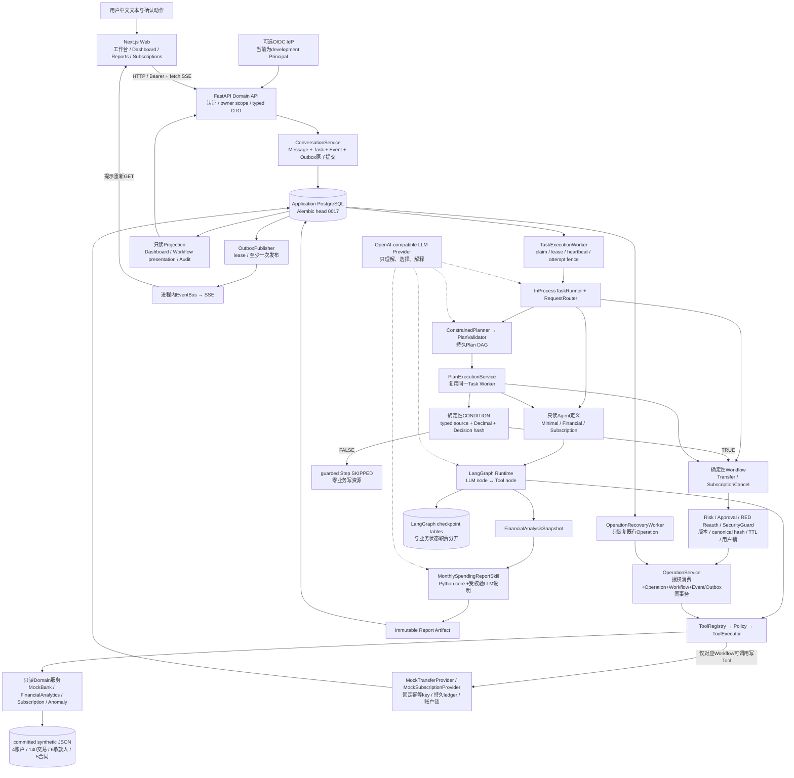
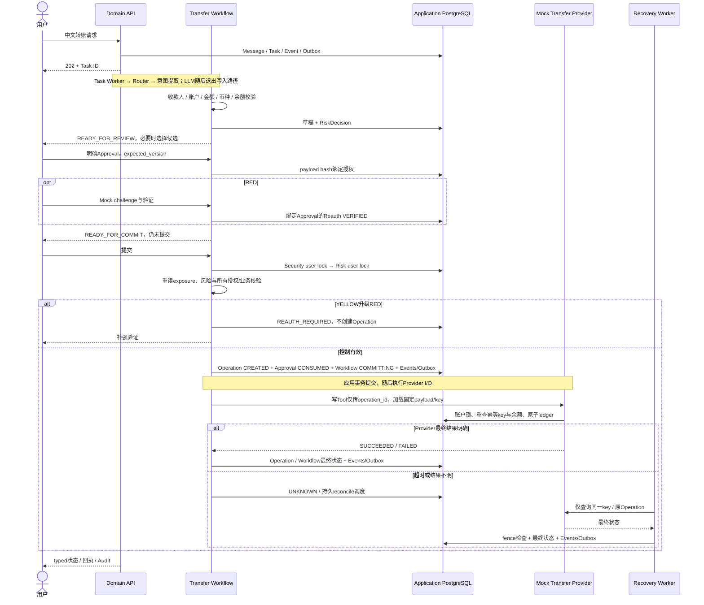

# 历史档案：当前系统架构

> 历史材料，保留原记录日期、版本和结论。旧风险规则、待办事项、测试数量与本地部署状态不代表 v0.10.3；当前说明见 [文档导航](../../../README.md)。

v0.9.2，2026-10-05。部署是**模块化单体**：Web、API、PostgreSQL三个Compose服务；API进程托管三个专用worker loop。图中模块不代表独立微服务，三个Agent不代表自由协商的Multi-Agent。

可直接打开 [完整SVG图](assets/system-architecture.svg) 或 [PNG图](assets/system-architecture.png)。下列Mermaid是可编辑的结构源。

## 1. 总体架构

Dashboard直接复用Domain服务与格式化器，不必经过Agent或LLM。独立业务、报告和简单查询仍走原路径，需要跨能力才进入Plan。CONDITION不是Tool/Agent Capability，TRUE不授权，FALSE跳过写步骤。

## 2. 转账写入时序

此时序省略订阅取消的对应路径：它固定YELLOW，不使用转账日累计和RED Reauth，采用自己的取消Provider/ledger，但共用Approval、Operation、Guard、Recovery、Event/Outbox框架。

## 3. 三种持久化职责

| 存储 | 内容 | 谁管理/用途 |
|---|---|---|
| Application PostgreSQL | Conversation、Message、Task、Event、Report、Workflow、Approval、Reauthentication、Operation、Outbox、identity mapping、Guard、Plan/Step/Dependency、Mock ledger | Alembic；业务事实、ownership、授权、任务调度和并发控制 |
| LangGraph PostgreSQL表 | checkpoint_migrations、checkpoints、checkpoint_blobs、checkpoint_writes | AsyncPostgresSaver；只保存Agent Runtime执行快照，不决定资金业务状态 |
| committed JSON | 合成账户基线、交易、收款人、订阅和Golden | MockBankService只读；有效余额减去成功ledger转出，取消ledger覆盖合同有效状态 |

应用库和checkpoint可以使用同一PostgreSQL实例/数据库，但表所有权不同。reset要求配置指向同一数据库以事务化清理所属用户状态；不是删除库/volume。

## 4. 安全与事实边界

| 边界 | 当前规则 |
|---|---|
| 身份 | 外部JWT经服务器验证与identity mapping；worker从Task/Conversation ownership构造ExecutionPrincipal。浏览器/LLM不能选择user_id |
| 工具 | Registry显式注册；Policy匹配caller、allowlist、risk_level和side_effect；默认拒绝。两个写Tool仅允许对应Workflow |
| 业务写入 | Workflow、Approval/hash/TTL、RED验证、Guard、commit-time风险、Operation与Provider多层控制 |
| 并发 | Guard用户锁→Risk用户锁保护新Operation；Provider账户锁保护余额；固定key/唯一约束保护重放；lease/fencing保护worker结果 |
| 金融事实 | Decimal+typed result；UI消费后端display和状态；LLM自然语言只作解释，双SUCCEEDED才显示业务成功 |
| 条件 | 读已完成typed source，用Decimal判断并持久Decision；FALSE直接SKIPPED。原文句式/币种未识别的缺口见R02/R03 |
| 审计 | 持久事件历史与当前资源分开，owner-scoped，有限payload与hash；不保存OTP/JWT/API key/隐藏推理，无WORM防篡改 |
| 通知 | Event+Outbox原子，至少一次发布；EventBus进程内，无跨进程保证或SSE replay，资源API是事实源 |

当前没有真实银行/商户连接、真实MFA、手机APP/IM/语音、RAG/向量库、长期记忆、通用代码执行沙箱、Celery/Redis/Kafka或自由Multi-Agent。示意中的OIDC是已实现认证边界的可选接入，不表示已配置生产IdP。

主要源码：`main.py`、`runtime/task_runner.py`、`application/operation_service.py`、`application/plan_execution_service.py`、`runtime/*worker.py`、`runtime/outbox_publisher.py`、`audit/projection.py`。
