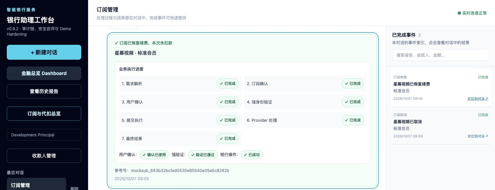
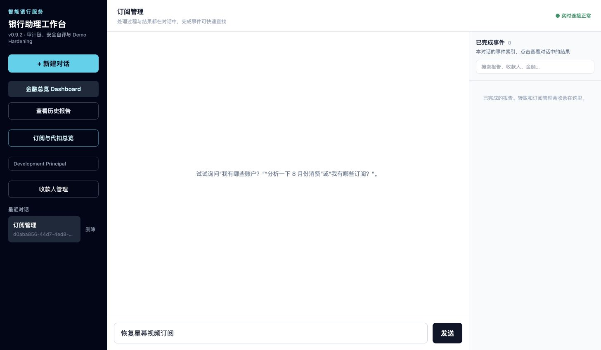
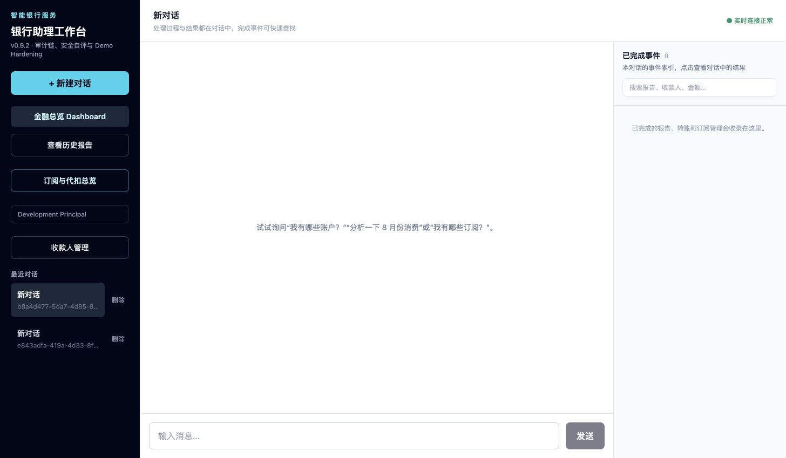
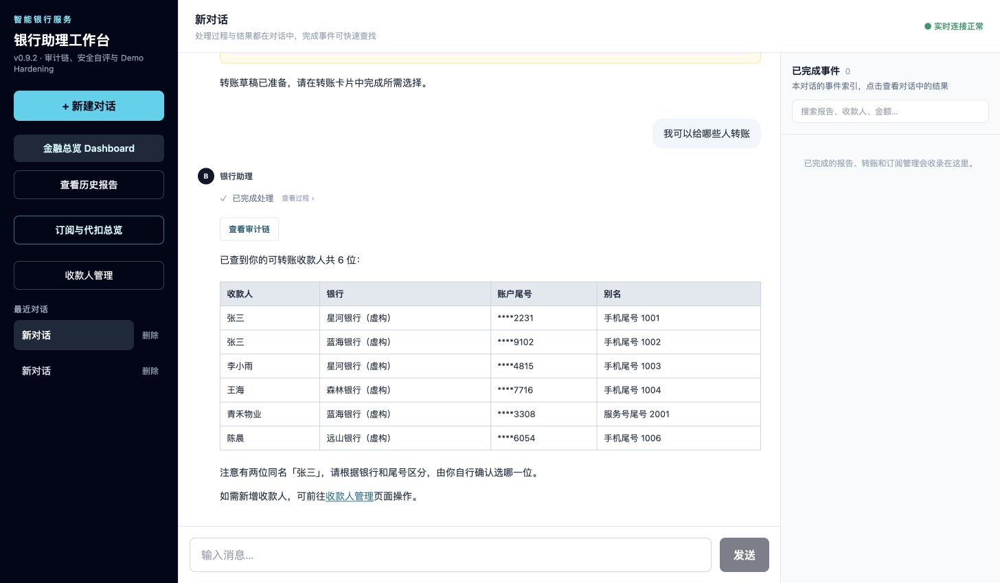
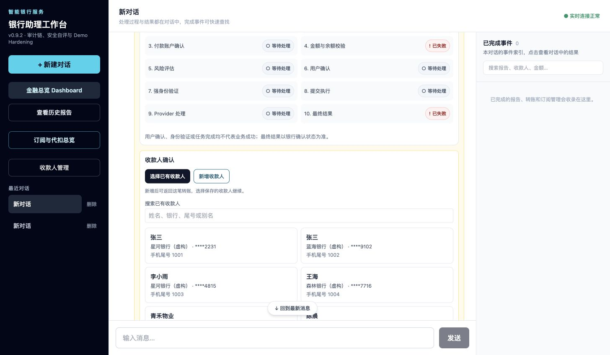

# 历史档案：Banking Agent 管理功能修复与验收

> 历史材料，保留原记录日期、版本和结论。旧风险规则、待办事项、测试数量与本地部署状态不代表 v0.10.3；当前说明见 [文档导航](../../README.md)。

完成日期：2026-10-07。沿用只读 Agent、确定性 Workflow、Approval、Reauthentication、Operation 和 Mock Provider 架构。

## 已实现

| 功能 | 当前行为 |
| --- | --- |
| 风险规则 | 所有转账均为 RED，确认后必须强验证。确认和提交重新校验；旧黄色草稿按新规则显示和执行，历史已提交风险事实保留。恢复订阅授权同样为 RED，取消订阅和保存收款人需要明确确认。 |
| 删除对话 | `DELETE /api/v1/conversations/{id}` 软删除。本人重复删除返回 204，活动任务／计划／工作流／未收敛 Operation 返回 409，越权返回 404。消息发送和删除使用同一行锁；保留业务与审计证据。前端提供确认弹窗、切换最近剩余对话、空列表引导、SSE 清理及其他标签页同步。 |
| 收款人 | 只读 Agent 可列举和搜索收款人；新增请求指向 `/payees`。页面核对后确认保存姓名、虚构银行、四位模拟账户尾号和可选别名。数据库与 fixture 统一查询，按用户隔离，重复保存不重复创建，新增收款人可完成转账。 |
| 订阅回答 | 聊天不渲染订阅分析卡片，正文保持可见；后端快照、总览、Dashboard、业务确认、验证及结果卡片保留。简单回答及 Plan 回复共用逻辑，末尾只追加一次总览提示。 |
| 恢复订阅 | `SUBSCRIPTION_RESUME` 支持选择合同、核对套餐／费用／下次扣款日、确认、强验证、提交和未知结果恢复。仅允许 Provider 支持恢复的 MANAGED 合同；恢复续费授权不产生即时扣款。持久化状态和动作账本支持取消→恢复→再取消，同合同串行、版本校验和幂等重试。 |

总览的取消／恢复链接进入工作台预填请求；用户发送消息后才启动流程。恢复保留未来账期，过期账期按原月度／年度周期推进，无账期时从恢复日顺延一个周期。成功结果及成本由后端状态决定。

## 自动化验收

以下检查均通过，PostgreSQL 使用独立的 `banking_management_01a11570_test` 数据库。

| 检查 | 结果 |
| --- | --- |
| 后端，排除 PostgreSQL 标记（含后续浏览器反馈修复） | 584 passed |
| PostgreSQL 并发和迁移 | 39 passed |
| 前端组件和展示规则（含后续浏览器反馈修复） | 31 passed |
| Ruff，API 源码／测试／迁移及 Demo 重置脚本 | 通过 |
| ESLint、TypeScript、Next.js 生产构建 | 通过 |
| `git diff --check` | 通过 |

核心覆盖：一元及小额转账强验证、失败／过期验证禁止创建 Operation、修改授权内容后重新确认；删除幂等和越权、活动流程拦截、PostgreSQL 删除与发送消息竞争；收款人确认、持久化、重复保存、用户隔离和完整转账；历史订阅快照不展示卡片；取消／恢复循环、零即时扣款、账期及成本、合同版本竞争、超时查询恢复和旧取消账本兼容。

可复跑命令（从仓库根目录执行后端命令，前端命令在 `apps/web` 执行）：

```sh
apps/api/.venv/bin/python -m pytest apps/api/tests -q -m 'not postgres'
TEST_DATABASE_URL='<独立 PostgreSQL 测试数据库 URL>' apps/api/.venv/bin/python -m pytest apps/api/tests -q -m postgres
apps/api/.venv/bin/ruff check apps/api/src apps/api/tests apps/api/migrations scripts/reset_demo_state.py
node --experimental-strip-types --test tests/*.test.mjs
node node_modules/eslint/bin/eslint.js .
node node_modules/typescript/bin/tsc --noEmit
node node_modules/next/dist/bin/next build
```

## 浏览器验收

使用临时前端、独立 SQLite、确定性的 Fixture LLM 和实际 API／Worker／Workflow／Mock Provider；未调用真实银行、真实支付或线上 LLM。

1. 收款人页面填写、核对并保存；对话查询可看到新增人，向新增人转账 1 元，RED → 确认 → 模拟强验证 → 提交 → 成功。
2. 转账尚未结束时删除被拦截；完成后软删除成功；删除当前对话自动切换到剩余对话，最后一个删除后显示新建引导。
3. 总览取消链接在空列表创建对话并预填，发送后确认取消；成功后总览出现恢复入口。
4. 恢复链接预填并发送，RED → 确认 → 模拟强验证 → 提交 → 恢复续费成功；回执明确本次未扣款。随后普通订阅查询只展示正文和一次总览提示。

恢复订阅成功回执：



删除当前测试对话后自动切换剩余对话：



## 迁移与上线

新增迁移 `0018_banking_management.py`，添加对话删除标记、收款人表、订阅当前状态和动作账本，以及恢复操作枚举。旧成功取消记录回填状态，原业务和审计记录保留。Demo 重置脚本已覆盖新增持久化数据。降级前若存在新增管理记录则拒绝执行，避免丢失数据。

2026-10-07 本地 Docker API／Web 已更新，数据库迁移到 0018；`http://localhost:3000/`、`http://localhost:8000/health` 及对话／收款人／订阅 API 均正常响应。更新前确认正在执行的 Task 和未收敛 Operation 均为零；暂停 Web／API 后完成数据库备份和迁移，再启动新镜像。原有两条对话保留，没有重置数据。迁移前备份保存于 `/private/tmp/banking-local-before-0018-20261007.dump`（仅当前用户可读）。

本地模拟强验证继续使用 `.env` 中配置的 `MOCK_REAUTH_CODE`，没有改动现有凭证配置。



后续其他环境上线顺序：

1. 在入口暂停新的业务写请求，保留查询和恢复 worker，让 CREATED／SUBMITTED／UNKNOWN Operation 收敛。
2. 备份数据库，在 API 环境执行 `alembic upgrade head`，确认版本为 0018。
3. 同步部署并重启 API 与 Web，检查旧待提交转账会要求强验证，以及总览的取消／恢复状态。
4. 恢复新的业务写请求。

默认继续使用 Mock 银行和模拟强验证；不包含真实银行接入或自动扣费引擎。

## 浏览器反馈修复

2026-10-07 根据四条页面标注完成后续调整，并重新构建、更新本地 3000／8000 服务：

- 收款人查询不再渲染工具结果框，历史与新回复均只显示文字回答；工具快照继续供审计使用。
- 移除侧栏的开发身份标签和对话 UUID；OIDC 模式仍保留登出功能。
- 转账收款人步骤提供“选择已有收款人”和“新增收款人”。已有收款人可按姓名、银行、尾号或别名筛选，同名账户仍分别选择。
- 新增入口打开收款人页面；返回链接定位原对话，新增后重新读取列表并由用户选择，没有自动确认或转账。
- 未匹配到收款人时等待用户补充；旧版尚无 Operation 的 `PAYEE_NOT_FOUND` 草稿可由用户重新选择。已删除对话、已提交或其他失败操作不能借此重启。
- 快捷选择一次提交姓名和收款人 ID，由后端重新验证当前用户的权威候选，按版本更新；更换收款人会使原确认与强验证失效。
- “我可以给哪些人转账”等独立查询采用确定性的只读路由，避免模型误判为转账。

实际浏览器验证了历史回答去重、侧栏清理、同名账户的快捷选项，以及新增页面返回原对话／草稿；未改动用户当前草稿，也未提交转账。快捷选择、保存后选择、历史草稿恢复、删除拦截和旧授权失效另由后端测试覆盖。




