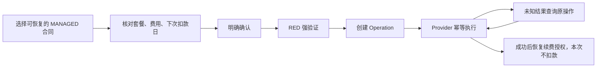

# AI Banking Agent v0.9.3 Implementation Report

版本：**0.9.3**。日期：**2026-10-07，Asia/Shanghai**。Alembic head：**0019**。

本版修复资金支出认证、对话生命周期、收款人管理及订阅恢复，并根据浏览器反馈精简聊天与侧栏。沿用 FastAPI + Next.js + PostgreSQL 模块化单体、只读 Agent、确定性 Workflow 和 Mock Provider，没有引入真实银行或扣费引擎。

配套：[测试结果](test-results-v0.9.3.md)、[当前目录树](repository-tree-v0.9.3.md)、[浏览器修复记录](banking-management-repairs.md)。

## 1. 问题与结果

| 原问题 | v0.9.3 行为 |
| --- | --- |
| 小额转账为黄色，可跳过强验证 | 所有受支持的转账均 RED，明确确认后必须完成有效 Mock 强验证 |
| 无法删除对话 | 软删除；未结束流程拦截；清理实时连接并切换剩余对话 |
| 收款人来自固定 fixture，普通查询不可用 | 只读 Agent 列表／搜索，页面核对后保存，数据库与 fixture 统一读取 |
| 订阅问题重复显示分析卡，取消后无法恢复 | 正文＋一次总览提示；持久合同状态支持取消、恢复、再取消 |
| 收款人结果框重复、开发标签和对话 UUID 干扰阅读 | 移除上述展示，保留后端结构化事实与正常认证 |
| 未匹配收款人导致转账草稿失败 | 新草稿等待选择；旧无 Operation 的匹配失败草稿可由用户重新选择 |

## 2. 风险与授权

| 操作 | 业务风险 | 控制 |
| --- | --- | --- |
| 账户、余额、收款人及订阅查询 | GREEN | 用户范围内自动读取 |
| 新增模拟收款人 | YELLOW | 页面核对后明确确认保存 |
| 取消可管理订阅 | YELLOW | Approval |
| 所有 CNY 转账、恢复原套餐续费授权 | RED | Approval + Reauthentication |

`workflows/transfer/risk.py` 不再按金额或日累计阈值决定强验证。日成功、执行中和预计暴露仍是后端事实，旧阈值字段保留用于历史兼容。非 CNY 转账继续拒绝，不做 FX。

确认与提交会重新校验资料、风险和授权。Operation 创建前检查 Approval hash／状态／TTL，以及绑定同一 Approval 的验证状态／TTL；失败、过期、跳过验证均不能创建新的资金支出 Operation。修改金额、收款人或订阅授权内容使原控制失效。

转账与恢复订阅共享认证动作处理和前端 `ReauthenticationForm`，复用失败次数限制与 Security Guard。旧未提交黄色草稿投影为 RED，提交前补充验证；已提交或完成的历史风险事实不重新评级。

## 3. 对话软删除

`ConversationModel.deleted_at` 保存删除标记。`DELETE /api/v1/conversations/{id}` 返回：

| 情况 | HTTP |
| --- | --- |
| 本人成功删除，或本人重复删除 | 204，无响应体 |
| Task、Plan、Workflow 未结束，或 Operation 尚未收敛 | 409 |
| 不存在或不属于当前用户 | 404 |

删除事务锁定本人 Conversation，再检查关联状态并保存删除事件与 Outbox。发消息使用相同行锁，保证“先发消息则删除被活动 Task 拦截；先删除则消息被拒绝”。暂停、等待用户、等待外部结果均不视为结束。

列表和聊天详情过滤删除项；删除后禁止发消息或重新启动相关流程，保留 Message、业务、Provider 和审计证据。Plan 用户动作及收款人草稿恢复也检查删除状态。

前端支持确认弹窗、409 说明、当前对话切换、空列表引导、SSE abort／404 处理、BroadcastChannel 和窗口恢复焦点时刷新。SSE 超时检查使用独立短会话，避免复用已经关闭的请求会话。

## 4. 持久化收款人

新增 `payees/service.py`、`/api/v1/payees`、只读 `list_payees` / `search_payees` 工具及 `/payees` 页面。Minimal Banking Agent 增加 `payee.list`、`payee.search`，没有保存或转账权限。

表单接受姓名、固定虚构银行、四位模拟尾号和可选别名；`confirmed=true` 才保存。数据库唯一键为用户＋姓名＋银行＋尾号，重复或并发保存复用同一记录。所有查询与保存按服务端 Principal 隔离，重启后仍可读取。fixture 与新增记录通过同一服务提供。

转账收款人步骤提供“选择已有收款人”与“新增收款人”；已有列表支持姓名、银行、尾号和别名筛选，同名多账户分别显示并由用户选择。新增页面的返回链接定位原对话，保存后仍需用户选择，不代替审批。

快捷选择一次提交姓名与 ID，后端根据当前用户的权威搜索结果校验 ID、检查版本并推进草稿。修改使旧 Approval／Reauthentication 失效。未匹配时等待补充；旧 `PAYEE_NOT_FOUND` 草稿仅在没有 Operation 且聊天未删除时允许恢复，其他终态不能借此重启。

常见独立“我可以给哪些人转账”请求使用确定性只读路由，避免分类模型把查询当成执行意图。复杂或带后续动作的请求仍走既有 Router／Planner 规则。

## 5. 订阅恢复与账期

新增 `SUBSCRIPTION_RESUME` Workflow／Approval／Operation 和 `SUBSCRIPTION_RESUME_WORKFLOW` Plan Capability，路由、Task 执行、审计、回执与前端状态同步支持恢复。

只有 Provider 明确允许恢复的 MANAGED 合同可恢复，DTO 的 `resumable` 由后端计算。DETECTED_ONLY 项提供商户办理提示。恢复的是原套餐续费授权，没有即时转账、支付或新增扣费任务。

保留尚未到期账期；过期时按原月度／年度周期推进到未来日期；缺少账期时从恢复日起顺延一个周期。日历计算保留原日锚点，并处理短月和闰年。费用、日期、动作和合同版本进入确认 hash；重新核对内容变化时要求重新确认。

新增 `mock_subscription_states` 当前状态及 `mock_subscription_actions` 动作账本。成功动作更新状态与版本；旧 `mock_subscription_cancellations` 事实保留，并回填或兼容读取旧取消状态。分析按当前状态计算订阅成本，包含没有历史扣费证据的可管理合同。

同用户同合同由进程锁和 PostgreSQL advisory lock 串行执行，再验证合同版本、状态和可恢复能力。固定 idempotency key 防重复应用；响应超时后的 UNKNOWN 由既有 recovery worker 查询原动作。Provider 确认成功前不显示“已恢复”。

内部订阅执行复用原 `workflow:subscription-cancel` 注册 caller，应用／Planner 路由分别标识取消和恢复；对应写 Tool 必须匹配 Operation 类型。该复用不扩大 Agent authority。

## 6. 回答与工作台

- `AssistantTurn` 不再渲染订阅分析卡或收款人查询结果框；历史快照也不重复展示，正文保持可见。
- 订阅简单回答、Workflow 引导和 Plan 汇总共用收尾函数，每次只追加一次“详细信息可在左侧「订阅与代扣总览」查看。”。
- 订阅分析快照继续用于条件判断和审计；总览、Dashboard、业务确认、强验证及成功回执保留。
- 取消／恢复总览入口只预填工作台消息，用户发送后才启动流程；空对话列表自动建立入口对话，并避免 StrictMode 重复创建。
- 侧栏删除开发身份标签与对话 UUID，OIDC 模式保留登出。
- 回复与完成索引使用动作类型区分取消和恢复；成功必须同时满足 Workflow 与 Operation SUCCEEDED。

## 7. API 与迁移

| 接口／契约 | 变化 |
| --- | --- |
| `DELETE /api/v1/conversations/{id}` | 新增软删除；客户端支持 204 |
| `GET /api/v1/payees?query=...&offset=...` | 用户范围内列表／搜索 |
| `POST /api/v1/payees` | 资料校验和明确确认保存 |
| `POST /api/v1/workflows/{id}/actions/select-payee` | 可提交 `recipient_query`，在同一次版本更新中校验快捷选择 |
| 订阅 DTO | `resumable`、合同版本和权威费用／账期等展示事实 |
| Workflow／Approval／Operation | `SUBSCRIPTION_RESUME` |

`0018_banking_management.py` 在 PostgreSQL 添加恢复枚举、删除列和三个管理表，回填旧成功取消状态，不重写历史审批／风险／审计。存在新增管理数据时拒绝直接降级。Demo scoped reset 覆盖新增收款人、状态和动作数据；只允许 dev/test，不能通过业务 API 调用。

上线先暂停新写请求、让现有 Operation 收敛、备份数据库，再迁移并同步更新 API/Web。升级不是 Demo reset，不清空现有业务。当前本地 3000／8000 环境保留原数据；版本同步与运行检查见测试文档。

## 8. 版本与验证范围

项目 package、Web／API-client package、API pyproject／uv lock／`__version__` 和页面标签同步 0.9.3。Demo preflight 比较 API 版本源与 Alembic head，不继续固定旧版本；Audit smoke 示例适配 RED 及 Mock 强验证。

本轮已有后端 584 项、PostgreSQL 39 项、前端 31 项通过记录；具体执行阶段、命令和浏览器证据以本版[测试结果](test-results-v0.9.3.md)为准。v0.9.2 的真实 LLM smoke、十次报告稳定性和 S1–S12 结果保留为历史记录，没有提升为本版重新执行的结果。

## 9. 限制

银行、订阅 Provider 与强验证均为 Mock；恢复不调用真实商户、不创建自动扣费引擎。不能订阅任意外部商户的新套餐。对话软删除没有产品恢复入口，记录保留供业务与审计使用。

Plan 仍最多八步、两个条件、一个写 Workflow，没有 ELSE、循环、任意表达式、动态重规划或报告 Artifact Capability。EventBus 仍在进程内，没有跨进程广播或 SSE replay；删除状态另以数据库和页面刷新检查收敛。

账户／风险／合同／执行事实由后端决定，但普通解释文本没有逐句 semantic entailment 校验。事件 append-only 不等同于数据库防篡改。本版没有新增真实 OIDC IdP、真实 MFA、FX、资金预留或退款。

## 账单分析故障修复补充

实际失败任务的审计事件显示，消费及异常问题先调用不存在期间的汇总，再补查和重复调用，触发四次工具预算；八月报告四个工具全部返回 `NO_TRANSACTIONS_IN_PERIOD`，仍进入 Skill，触发缺少汇总错误。原上下文没有业务日期，模型需自行猜年份。

- `ContextBuilder` 注入 `reference_now()` 的日期、年份与期间规则，近期消费默认最近完整自然月，异常使用工具的近三十天窗口。
- 财务 Agent 用完预算后移除工具定义，要求依据已有证据回答；权限和工具上限仍保留。
- 报告必须有成功的汇总与分类才能进入 Skill。数据不足时返回说明，不保存报告，也不伪造数值。
- 原聚合仅支持 `YYYY-MM`，新增 `YYYY` 自然年边界、全年分类与排名、上年同比。金额仍由 Decimal 算法计算。
- 报告 Pipeline、Router 与展示适配年度期间。数据库 `MONTHLY_SPENDING` 类型、既有 Skill ID 保留兼容，不新增迁移；报告标题、分类变化和比较明确标为年度／较上年。

真实模型在本地 Mock 银行数据上定向复测；未修改或重置用户已有业务记录。详见测试文档补充。

## 模拟账单历史扩容

固定种子 `20260920`，历史扩展使用独立种子，覆盖 2025-01-01 至 2026-10-07。共 1,207 笔：1,173 笔 POSTED、17 笔 PENDING、17 笔 REVERSED；4 个原账户、6 个收款人、5 个合同保持原有结构与账户余额。保留原有七八月回归金额、ID 和排名；补齐历史与九月末、本月记录。

历史包含工资调整、季度与年终奖金、季节性水电、日常餐饮通勤、生鲜采购、旅行、健康、购物退款、订阅历史涨价及转账双边记录。固定场景覆盖金额突增、新商户大额、短时重复、订阅涨价四类异常。待入账、撤销及 TRANSFER 排除遵循既有统计规则。

`generate_mock_data.py` 已同步当前合同 schema，保证重复生成不会还原成旧字段；校验检查连续月份、分类、状态、账户归属、重复 ID、金额及脱敏字段。独立 Decimal 参考文件扩展到全部 22 个月份、两个年度及逐月／年度比较，旧月度报告黄金文件不改动。

账单属于 JSON fixture，API 启动时加载；PostgreSQL 中的用户会话、成功操作、订阅合同当前状态及审计不重置。既有报告是不可变历史快照，扩容后的新报告使用新数据。2026 年报告涵盖截至模拟截止日的数据，不代表尚未发生的年底交易。

## 对话名称与一次性订阅预填

订阅跳转 URL 原先一直保留 resume／cancel 参数，输入框重新挂载导致重复预填。现首次读取后清理参数，保留其他查询、hash 和 history state；新建或切换对话不会重复填入。再次明确点击链接仍可预填，跳转不代表业务确认。

新增 owner-scoped PATCH /api/v1/conversations/{id}，名称去除首尾空白、最长一百字符、拒绝空白及控制字符；越权和已删除对话为 404。侧栏「改名」弹窗保存，并由 conversation.updated SSE 及跨标签刷新同步。

首次助手回复写入前锁定对话，使用最早用户请求生成有界标题并脱敏长数字，不额外调用模型。已有回复后不再次生成。迁移 0019 持久化 title_is_custom，保护手动名称（包括手动设为「新对话」）和历史非默认名称。已有结束的默认对话不批量重命名。标题与首次回复同事务提交；行锁处理与手动改名的并发。
