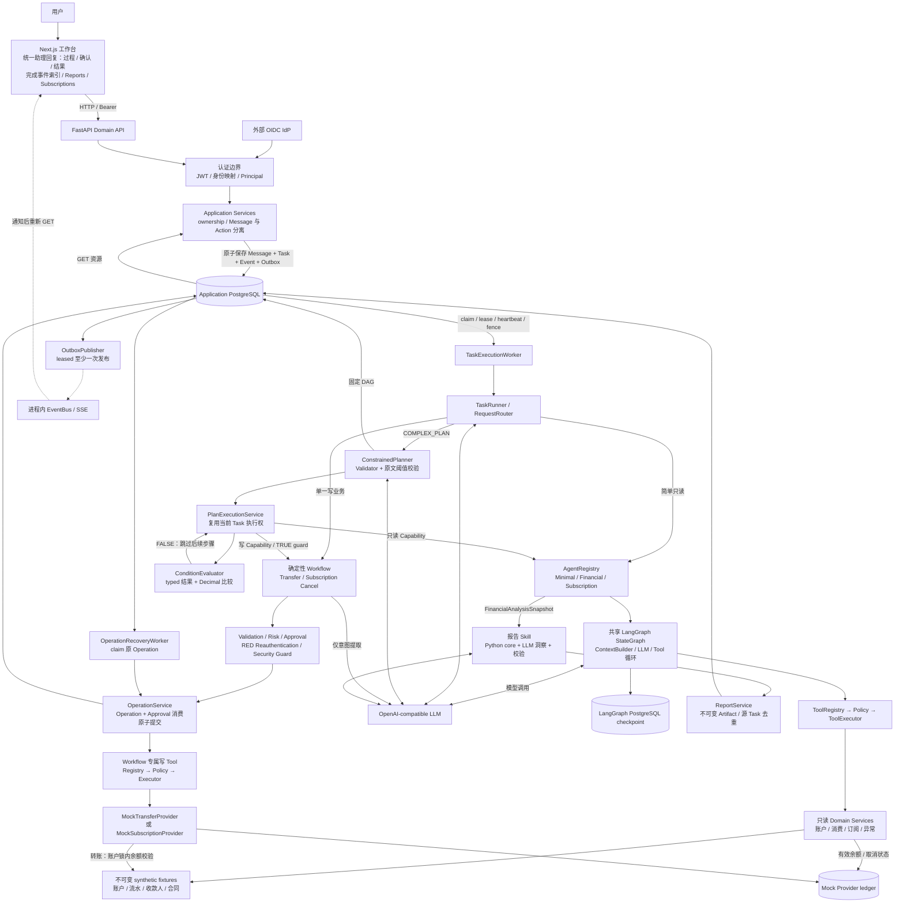
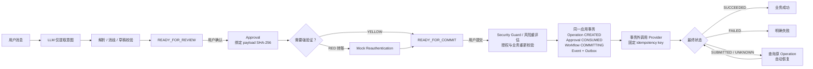

# AI Banking Agent：当前系统架构

版本：**v0.8.2**。核对日期：**2026-10-02**。

这是 Next.js + FastAPI + PostgreSQL 的模块化单体。三个业务 Agent 共用 LangGraph Runtime；三个专用后台循环负责 Task 执行、Operation 恢复与 Outbox 发布。没有 Agent 自由协商或微服务集群。

配套：[版本路线与网页测试](learning-guide-v0.8.2.md) · [核心算法说明](core-algorithms-v0.8.2.md)。

## 1. 总体架构图

实线表示请求、执行或数据读写，虚线表示通知。OIDC 是已实现的可选认证边界，实际 IdP 尚未接入；沙箱可以显式使用开发 Principal。

Application 表、checkpoint 表与 Mock Provider ledger 可以在同一 PostgreSQL 部署，图中分开用于说明职责。Agent 结果由 Application 构造快照；报告 Skill 仅在独立报告路径执行，Plan 尚不支持 Report Artifact Capability。

前端按来源消息与 Task 关联将执行过程、Plan、Workflow 和最终结果放入同一条助理回复。SSE 通知触发资源与执行记录刷新，右侧完成事件索引通过结果 ID 定位正文，具体交互见[网页工作台改进与验收](web-workbench-ui-improvements.md)。

## 2. 写业务的执行与授权边界

审批、强验证、提交使用 Action API，聊天文字不能替代授权。UNKNOWN 只查询原操作；CREATED 恢复可以使用原 key 提交。已创建 Operation 后不重新消费 Approval，也不因后续写锁取消原授权意图。

转账 YELLOW 需 Approval，RED 需 Approval + Reauthentication。订阅取消固定 YELLOW，仅 Approval，必须有可管理合同。转账 Provider 扣减有效余额，订阅 Provider 写取消 ledger，没有账户余额扣减逻辑。

## 3. 谁保存什么事实

| 状态 / 数据 | 事实源 | 职责 |
|---|---|---|
| 当前用户 | Principal + identity_mappings | 内部 user_id 决定资源及银行数据范围 |
| Conversation / Message / Task | 应用 PostgreSQL | 输入、执行调度、lease/attempt、结果 |
| Plan / Steps / Dependencies / Decision | 应用 PostgreSQL | 固定图、步骤事实、条件证据、等待/接管/回退 |
| Workflow / Approval / Reauthentication | 应用 PostgreSQL | 业务状态、绑定授权、TTL、验证结果 |
| Operation | 应用 PostgreSQL | 产品执行意图、稳定 key、结果与恢复计划 |
| Provider fact | mock_bank_transfers / mock_subscription_cancellations | 模拟银行实际应用的副作用 |
| 银行初始基线 | committed JSON fixtures | 初始余额、固定流水、收款人与合同 |
| Agent 执行进度 | LangGraph checkpoint 表 | 图状态，不能代替 Task ownership 或业务事实 |
| Report | 不可变 content_json + provenance | 保存生成当时内容，GET 不重新生成 |
| Event / Outbox | 应用 PostgreSQL | 不可变事件与待发布意图，同事务提交 |
| 安全写锁 | security_guard_states | 失败窗口、原因与期限，跨重启保留 |
| 浏览器 state / SSE | 展示与通知 | 触发 GET，不能决定审批或成功 |

有效余额 = 初始余额 − 该用户该账户成功转出；有效订阅状态 = 初始合同状态叠加成功取消。当前固定消费分析不自动合并新的转账 ledger。

## 4. 后台循环与并发保护

| 后台组件 | 对象 | 权威控制 |
|---|---|---|
| TaskExecutionWorker | 用户请求，包括整个 Plan | due scan、SKIP LOCKED、lease、heartbeat、attempt fencing |
| OperationRecoveryWorker | CREATED/SUBMITTED/UNKNOWN | due scan、lease、owner/expiry/version fence、原 key 恢复 |
| OutboxPublisher | 尚未发布的 Event intent | due scan、lease、owner fence、退避、至少一次发布 |

没有独立 Plan Worker，三个 loop 均由 API process 托管。网络/LLM/Provider I/O 不持有应用长数据库行锁。

| 并发保护 | 保护目标 | 范围 |
|---|---|---|
| Security Guard 用户锁 | 写锁激活与新 Operation 创建有确定先后顺序 | 应用事务直到 commit |
| Transfer Risk 用户锁 | 同用户并发不能绕过日累计强验证 | 重读 exposure → 检查控制 → 创建 Operation |
| Provider 付款账户锁 | 不同 Operation 不并发花穿余额 | Provider 余额决定与 ledger 提交事务 |

Transfer 应用侧顺序固定为 **Security Guard 用户锁 → Transfer Risk 用户锁**。应用提交后才进行 Provider I/O，Provider 自己获得账户锁。key 唯一性负责同笔不重复，账户锁负责不同笔不透支。

## 5. 源码阅读入口

以下路径相对于 `apps/api/src/banking_api/`：

| 层 | 入口 |
|---|---|
| 组件注册与生命周期 | main.py |
| HTTP 认证 / 资源访问 | api/dependencies.py、api/routes/、security/authentication/ |
| 路由与任务 | routing/request_router.py、runtime/task_runner.py、runtime/task_execution_worker.py |
| Agent 与工具权限 | runtime/langgraph/graph.py、context/builder.py、tools/executor.py、policy/service.py |
| Plan、条件与用户控制 | planning/、application/plan_execution_service.py、plan_service.py、plan_wake_service.py |
| 消费与报告 | financial/、skills/monthly_spending_report.py、skill_runtime/executor.py |
| 写业务与恢复 | application/workflow_service.py、operation_service.py、workflows/、transfers/、subscriptions/provider.py、runtime/operation_recovery_worker.py |
| 事件与安全锁 | runtime/event_publisher.py、outbox_publisher.py、security/guard.py |

前端为 `apps/web/features/` 的 Conversation/Task/Plan/Report/Workflow/Subscription/Anomaly/Security；生成 API 类型为 `packages/api-client/src/schema.d.ts`。

## 6. 当前限制

Plan 最多8步、2个条件、1个写 Workflow，ready steps 顺序执行；无 ELSE、嵌套条件、任意表达式、循环、动态重规划。没有 RAG、向量数据库、长期记忆、MCP 银行接入或 Redis/Celery/Kafka。

OIDC-ready 边界已实现，真实 IdP/强验证未接入。无真实银行/商户写入、FX、余额预留、转账撤销/退款或金融回退。

EventBus 是进程内的，Outbox 不保证其他 API process 的 SSE 客户端收到；无 SSE replay 或浏览器 ACK。Resource API 是恢复事实的入口。
