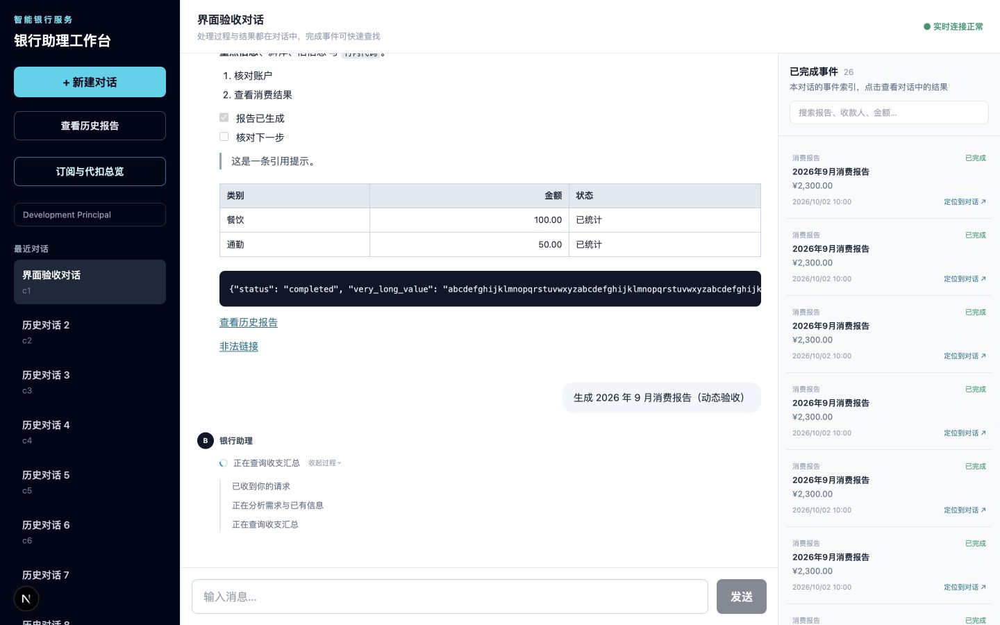
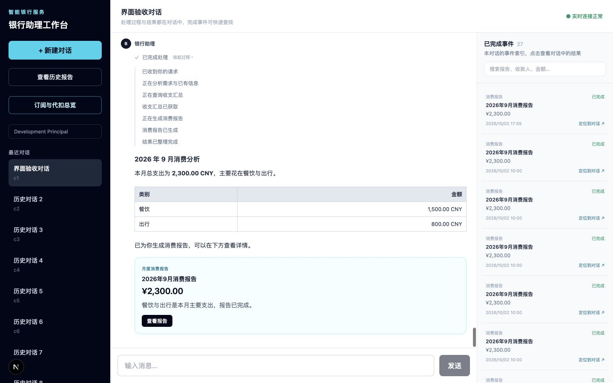

# 网页工作台改进与验收

日期：2026-10-02。基于 v0.8.2，改进对话展示、独立滚动与完成事件查询。

## 现在如何使用

每个请求对应一条助理回复：上方是动态处理过程，下方是 Markdown 答复和业务结果。处理过程、确认动作与结果都留在这条回复中；完成后默认收起过程，可以随时重新展开。

| 区域 | 内容 | 滚动方式 |
| --- | --- | --- |
| 左栏 | 新建对话、报告/订阅入口、历史对话 | 独立滚动 |
| 中栏 | 用户消息和助理回复；回复包含处理过程、确认操作、答复、报告和回执 | 消息区独立滚动，标题和输入框固定 |
| 右栏 | 本对话已完成的报告、转账、订阅取消事件索引 | 索引独立滚动，搜索框固定 |

右栏可按报告、收款人、金额或参考号搜索；点击条目会滚动到对话中的完整结果并高亮。普通账户查询不收录到完成索引。窄屏通过“对话 / 已完成事件”切换，点击索引后自动返回对话。

页面高度固定为当前视口，长代码块和宽表格在消息内部横向滚动。阅读历史消息时，新进度不会强制跳到底部；发送新消息或点击“回到最新消息”可以继续跟随最新内容。

## 如何实现

- `timeline.ts` 按 `Task.input.message_id` 关联来源请求，按 `Task.output.assistant_message_id` 关联答复，按 `source_task_id` 关联 Plan、Workflow 和 Report。请求处理中到完成时保持同一个回复结构，并发请求的答复不会按完成顺序串到另一条请求下。缺少旧消息的成果也有中央展示位置。
- `AssistantTurn` 统一显示处理摘要、Markdown 正文和结果。报告、订阅/异常分析及转账/取消回执直接显示在正文中；待确认业务的选择、确认、验证、提交动作也直接可见。
- `ResponseProcess` 处理时展开、结束后收起。通过已有 `/tasks/{id}/events` API 读取真实的需求分析、工具查询、报告生成等执行记录，使用适合用户阅读的中文描述。这是执行步骤摘要，未展示模型内部推理原文。
- 补齐 LLM、Tool、Skill 与 Plan/Task 的 SSE 事件监听。即使工具执行不改变 Task 版本，也会刷新处理记录。事件合并刷新完整资源，连接恢复后补读状态，请求版本检查防止旧响应覆盖新状态。
- 业务状态优先于后台 Task 状态：Task 完成可能仅表示草稿已建立。成功回执和右侧索引都要求 **Workflow 与 Operation 均为 SUCCEEDED**，待确认、失败和结果未知时保留实际状态。
- Report 来自持久化列表并按页加载，已有报告不会因 Task 输出清空或计划回退而消失。右侧只显示简要事件条目，通过结果 ID 定位中央正文。
- `react-markdown` + `remark-gfm` 支持标题、粗体、列表、引用、表格、任务列表、链接和代码块。用户输入保留原文，不执行消息中的原始 HTML，链接使用默认安全 URL 过滤。
- 主布局使用 `h-dvh`、逐层 `min-h-0 / min-w-0` 与独立 `overflow-y-auto`，避免长内容撑高整页。

## 网页验收教程

访问 [工作台](http://localhost:3000)。Docker 模式更新前端：

```bash
docker compose build web
docker compose up -d --no-deps web
```

| 操作 | 预期结果 |
| --- | --- |
| 输入“我有哪些账户？” | 用户消息下出现一条助理回复；其中显示动态分析/查询步骤，完成后同一条回复显示账户答复并收起过程 |
| 点击完成回复的“查看过程” | 重新加载服务器保存的执行记录；刷新后仍可查看 |
| 输入“请用 Markdown 表格列出我的账户，并用列表总结余额” | 答复的表格、列表正常排版；普通查询不出现在右侧索引 |
| 输入“生成一份 2026 年 8 月消费报告” | 处理过程显示查询和报告生成，完成后正文直接显示答复与报告；“查看报告”打开详情 |
| 在右侧搜索报告月份或金额，点击匹配条目 | 对话滚动到对应报告并高亮，报告始终在回复正文中 |
| 输入“先查一下工资卡余额，再分析一下 2026 年 9 月消费” | 步骤与状态融合在回复的处理过程里；结果显示在正文；接管/恢复/回退仍可展开操作 |
| 按原有 Mock Provider 转账流程核对、确认并执行 | 选择、确认、验证、提交均在回复中；银行确认后同一位置显示完整回执，右侧增加简要索引 |
| 搜索收款人、金额或转账参考号 | 匹配已确认成功的事件，点击定位到中央回执 |
| 查看待确认、COMMITTING/UNKNOWN 或失败的转账 | 正文保留实际状态和必要操作，没有成功回执或完成索引 |
| 完成一笔 Mock Provider 订阅取消 | 同一回复中显示处理与成功回执，右侧收录已完成事件 |
| 累积历史对话、长消息与多份报告后分别滚动三栏 | 只滚动当前栏，页面高度不增长，输入框一直可见 |
| 缩小到手机宽度，切到“已完成事件”后点击条目 | 自动回到“对话”并定位正文结果，长内容不撑宽或撑高整页 |

## 验证记录

```bash
pnpm web:lint
pnpm web:typecheck
pnpm --filter @banking/web test
pnpm web:build
```

- Lint、类型检查与生产编译通过；8 个行为测试覆盖回复稳定性、并发关联、历史数据兼容、成果保留和成功确认边界。
- 独立本机示例 API 的浏览器验收覆盖 1440 × 900 和 390 × 844、50 条历史对话、25 份初始报告与多种业务状态。
- 按阶段推进一条报告请求：分析 → 查询 → 生成 → 完成。查询事件未改变 Task 版本时仍动态更新；全过程只有一条助理回复；结束后自动收起过程，Markdown 答复与报告仍直接可见。
- 右侧报告搜索与转账参考号搜索均匹配正确，点击后中央结果获得焦点和高亮；手机端自动切回对话。未知与失败交易没有成功条目。
- 三栏滚动、历史阅读位置保持、Markdown 排版和安全 HTML/链接过滤沿用此前验收结果。
- 更新本地网页容器后，在 3000 端口核对现有历史数据：8 条请求对应 8 条助理回复，正文有 1 份报告与 1 份成功转账回执，右侧索引共 2 条；索引定位报告成功，实时连接正常，无加载错误。

浏览器动态场景使用示例数据，未提交真实银行交易。业务确认、强验证与提交沿用原 API 和版本校验。本次对话整合没有修改后端业务逻辑。

本地 API 已是 0.8.2、数据库迁移至 0017（前一轮更新完成）；前端单独重建后可在现有 [3000 端口工作台](http://localhost:3000) 使用。

处理中的示例：



完成后的示例（展开过程，同时展示正文答复与报告）：


